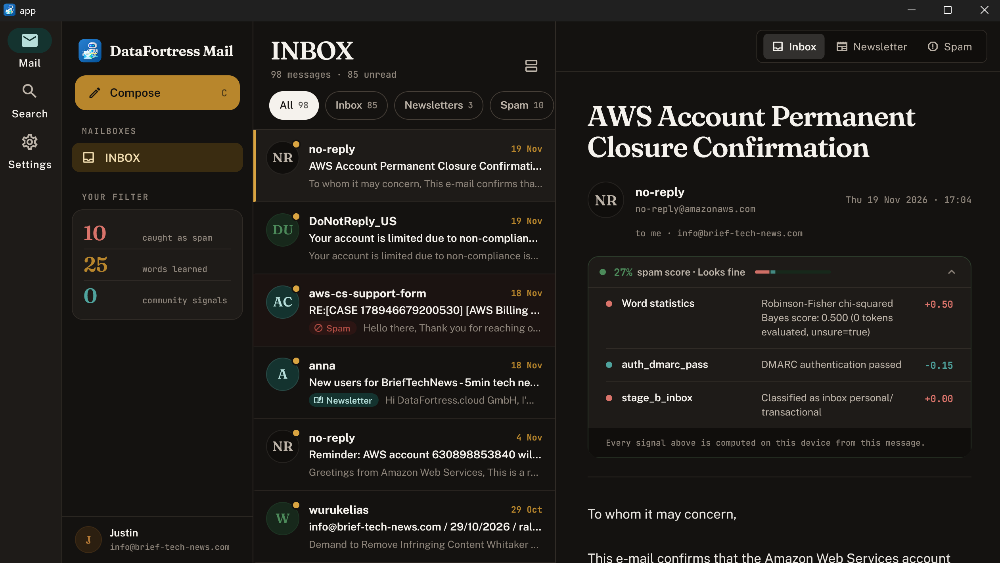
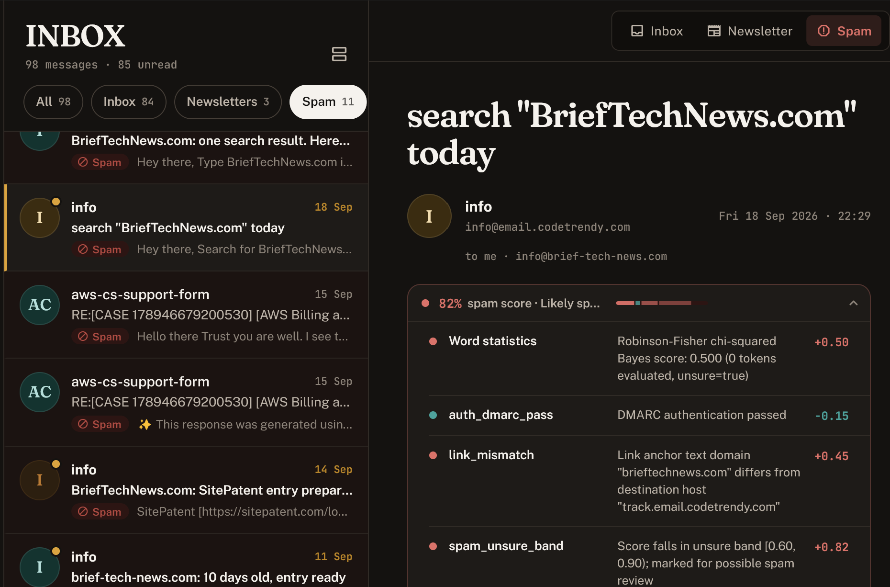
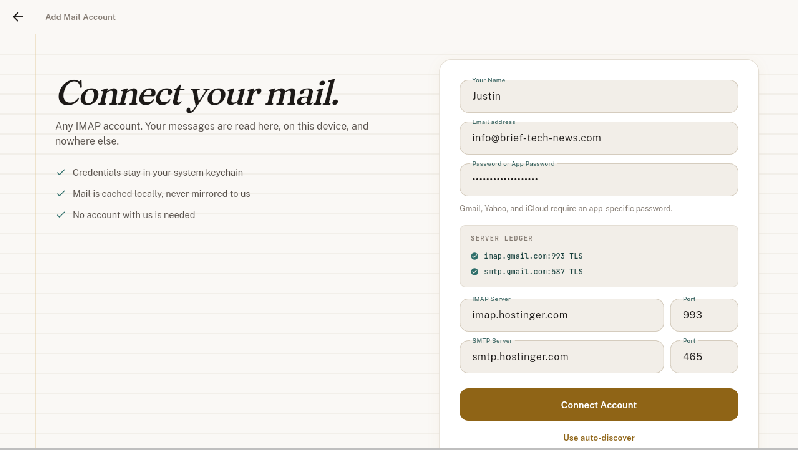
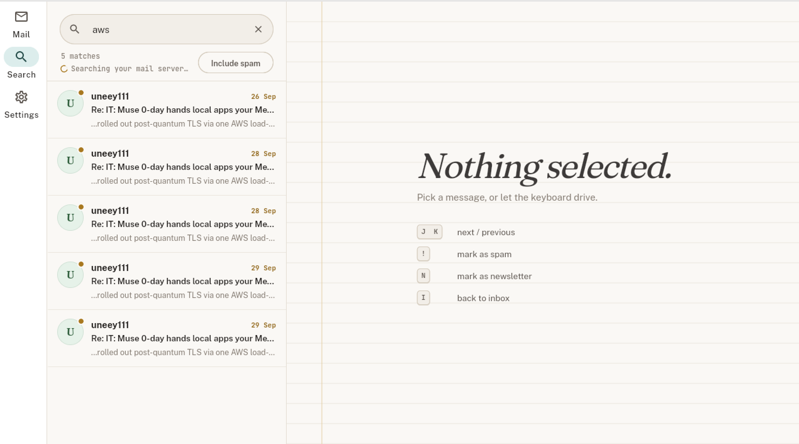
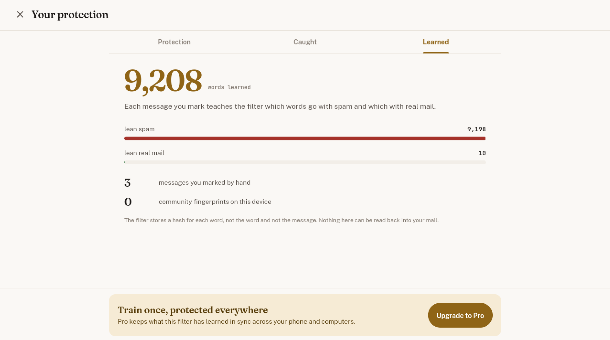

<p align="center">
  
</p>

# DataFortress

**An email client whose spam filter you can read, train and audit.**

<p align="center">
  <a href="https://github.com/JustinGuese/flutter-spamfiltering-emailclient/actions/workflows/build.yaml"></a>
  <a href="https://github.com/JustinGuese/flutter-spamfiltering-emailclient/releases/latest"></a>
  <a href="https://github.com/JustinGuese/flutter-spamfiltering-emailclient/releases"></a>
  <a href="LICENSE"></a>
  <a href="https://justinguese.github.io/flutter-spamfiltering-emailclient/"></a>
</p>

<p align="center">
  <a href="https://justinguese.github.io/flutter-spamfiltering-emailclient/"><b>Documentation</b></a> ·
  <a href="#download">Download</a> ·
  <a href="https://justinguese.github.io/flutter-spamfiltering-emailclient/getting-started/install/">Get started</a> ·
  <a href="https://justinguese.github.io/flutter-spamfiltering-emailclient/concepts/privacy-model/">Privacy model</a>
</p>

<p align="center">
  
</p>

Most spam filters are black boxes that live on someone else's server, which means your mail has to pass through someone else's cloud first. DataFortress is a Flutter IMAP/SMTP client for iOS, Android, macOS, Windows and Linux that does the filtering on your device instead. A Robinson-Fisher Bayes classifier, SPF/DKIM/DMARC signals and link heuristics produce a score, and the Evidence Sheet shows the exact tokens behind every verdict. One tap on Inbox, Newsletter or Spam trains the filter.

Collective defense works without identifying anyone. Clients share MinHash fingerprints and URL hashes behind a hashcash proof-of-work, with no user ID, no device ID and never any message content. The engine is a standalone pure-Dart package (`spam_core`) that you can use in your own project.

---

## Features

- **"The Ledger Desk" Design**: Restrained ink-on-paper aesthetic with responsive adaptive layouts (single stack, two-pane, three-pane) and list density toggles. Includes bundled typography (Fraunces, Public Sans, JetBrains Mono) with zero runtime Google Fonts network calls.

  <p align="center">
    
  </p>

- **Transparent Local Spam Filter**: Local Robinson-Fisher Bayesian analysis with 3-way classification (Inbox · Newsletter · Spam) and an interactive Evidence Sheet that details exact token weights, SPF/DKIM/DMARC authentication signals, and heuristic flags.

  <p align="center">
    
  </p>

- **Everyday Mail Client**: Multi-account IMAP/SMTP (password, or Google and Microsoft sign-in via OAuth2), local new-mail notifications (every message, bundled every 5 minutes, or hourly), Sent folder, Reply / Reply All / Forward with proper threading headers, attachments in both directions (attach files up to 18 MB; received files download from your mail server when you open them; forwards keep the original's files), and a full-screen reading view.

  <p align="center">
    
  </p>

- **Search**: On-device full-text search over subjects, senders, recipients and message text. Words match as you type and are ranked by relevance; operators such as `from:`, `subject:`, `is:unread`, `has:attachment` and `after:2026-01-01` narrow it down. Results from the device appear at once; once you pause typing, your own mail server is asked too (IMAP `SEARCH`), so older mail and folders that are not synced (Archive, custom folders) are found, and the hits are stored locally. Nothing goes to the DataFortress backend.

  <p align="center">
    
  </p>

- **Your Protection Screen**: Tap the filter card in the sidebar for a full-screen replay of your own spam: what would reach the inbox with no filter, with the on-device filter, and with community fingerprints added, plus what the filter has learned and what Pro adds (encrypted multi-device sync).

  <p align="center">
    
  </p>

- **Safe Auto-Unsubscribe**: When you mark an email as spam, the app can automatically unsubscribe via RFC 8058 One-Click (HTTPS POST) or RFC 2369 mailto. Unsubscribing talks directly to the sender's published endpoint—never through DataFortress servers. Built with comprehensive safety: a 10-second undo window, SSRF protection (HTTPS port 443 only, private/internal IP blocking, no redirects), clean request hygiene (no cookies or auth headers), sender authentication check (requires DMARC or DKIM pass), rate limiting (20/day), 30-day idempotency deduplication, and an on-demand Unsubscribe button in the reader view. Off switch in Settings (`auto_unsubscribe`).
- **Privacy-First Architecture**: Aggressive client-side HTML sanitization (strips scripts, forms, and inline styles), remote image blocking by default with per-sender overrides, and hardware-backed credential storage via OS keychains.
- **Anonymous Collective Defense**: Zero-ID spam and ham reporting using privacy-preserving MinHash LSH fingerprinting and hash proof-of-work—no user identifiers, tokens, or email bodies are ever transmitted.
- **Open-Core Model**: The client application and core `spam_core` engine are fully open source. Hosted community reputation aggregation and encrypted sync services represent commercial extensions.

---

## Download

Every link below points at the **newest release**, so it never goes stale. Builds are produced by the [Build & Release workflow](https://github.com/JustinGuese/flutter-spamfiltering-emailclient/actions/workflows/build.yaml); browse older versions on the [releases page](https://github.com/JustinGuese/flutter-spamfiltering-emailclient/releases).

| Platform         | Download                                                                                                                                                           | Format            | Notes                                                                                           |
| ---------------- | ------------------------------------------------------------------------------------------------------------------------------------------------------------------ | ----------------- | ----------------------------------------------------------------------------------------------- |
| 🐧 Linux (x64)   | [DataFortress-Mail-linux-x64.tar.gz](https://github.com/JustinGuese/flutter-spamfiltering-emailclient/releases/latest/download/DataFortress-Mail-linux-x64.tar.gz) | `.tar.gz`         | Extract and run the bundled binary. Needs `gnome-keyring` / `libsecret` for credential storage. |
| 🪟 Windows (x64) | [DataFortress-Mail-windows-x64.zip](https://github.com/JustinGuese/flutter-spamfiltering-emailclient/releases/latest/download/DataFortress-Mail-windows-x64.zip)   | `.zip`            | Extract and run the `.exe`.                                                                     |
| 🍎 macOS         | [DataFortress-Mail-macos.zip](https://github.com/JustinGuese/flutter-spamfiltering-emailclient/releases/latest/download/DataFortress-Mail-macos.zip)               | `.zip`            | Unzip and move the app to Applications.                                                         |
| 🤖 Android       | [DataFortress-Mail-android.apk](https://github.com/JustinGuese/flutter-spamfiltering-emailclient/releases/latest/download/DataFortress-Mail-android.apk)           | `.apk`            | Sideload; allow installs from unknown sources.                                                  |
| 📱 iOS           | [DataFortress-Mail-ios-unsigned.ipa](https://github.com/JustinGuese/flutter-spamfiltering-emailclient/releases/latest/download/DataFortress-Mail-ios-unsigned.ipa) | `.ipa` (unsigned) | Must be re-signed with your own certificate (e.g. AltStore, Sideloadly) before installing.      |

| Release                                                                                                                                                                                        | Build status                                                                                                                                                                                                                 | Docs                                                                                                                                                                                               |
| ---------------------------------------------------------------------------------------------------------------------------------------------------------------------------------------------- | ---------------------------------------------------------------------------------------------------------------------------------------------------------------------------------------------------------------------------- | -------------------------------------------------------------------------------------------------------------------------------------------------------------------------------------------------- |
| [Latest release](https://github.com/JustinGuese/flutter-spamfiltering-emailclient/releases/latest) · [All releases](https://github.com/JustinGuese/flutter-spamfiltering-emailclient/releases) | [](https://github.com/JustinGuese/flutter-spamfiltering-emailclient/actions/workflows/build.yaml) | [Install guide](https://justinguese.github.io/flutter-spamfiltering-emailclient/getting-started/install/) · [Full documentation](https://justinguese.github.io/flutter-spamfiltering-emailclient/) |

---

## Build from source

```bash
git clone https://github.com/JustinGuese/flutter-spamfiltering-emailclient.git
cd flutter-spamfiltering-emailclient/app
flutter pub get
GDK_BACKEND=x11 flutter run -d linux --dart-define-from-file=oauth.defines.json --debug
```

---

## Documentation

Full documentation is published at **<https://justinguese.github.io/flutter-spamfiltering-emailclient/>**. It covers installation, configuration, filter architecture, the privacy model, the backend protocol and contribution guidelines. The sources live in [`docs/`](docs/index.md).

---

## License

DataFortress is licensed under the [Apache License, Version 2.0](LICENSE). See [NOTICE](NOTICE) for trademark restrictions and bundled third-party font notices.

Under our open-core model, the email client and filtering engine are open source, while hosted collective reputation and sync services are proprietary.
