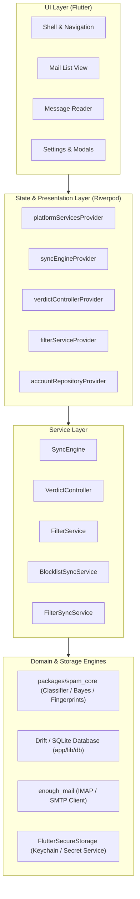
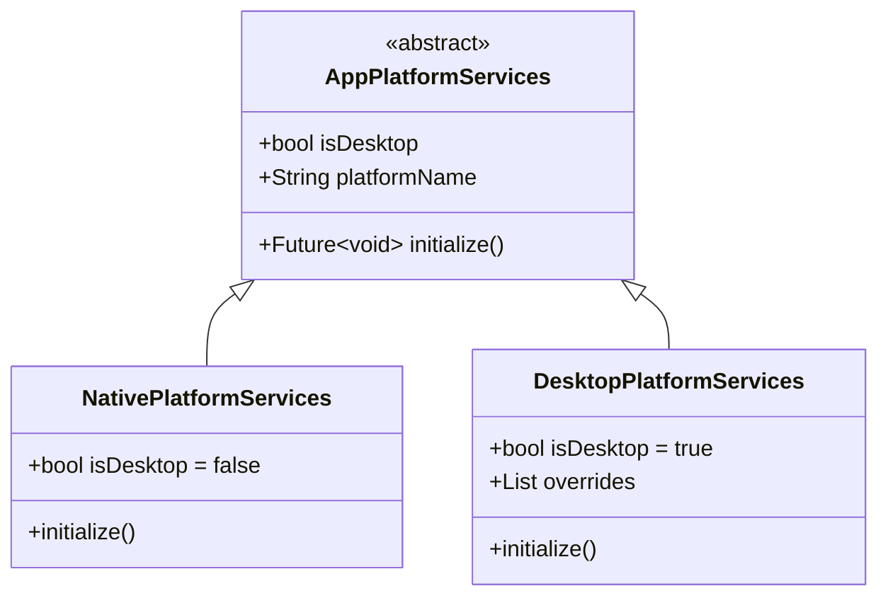

# Application Architecture

This document describes the architectural layout, core subsystems, platform split, and message processing pipeline in DataFortress Mail.

## Layer Overview

DataFortress Mail is structured into distinct architectural layers separating user interface components from state providers, background services, and underlying database/protocol libraries:

### Layer Responsibilities

- **UI Layer (`app/lib/ui/`)**: Built with Flutter and the Ledger Desk design system. Renders folder sidebars, message lists, sanitised email bodies, and configuration dialogs. Never connects directly to sockets or network clients.
- **Provider Layer (`app/lib/platform/`, `app/lib/filter/`, `app/lib/mail/`)**: Riverpod notifiers and providers managing reactive application state, folder selections, list density, account lists, and background sync triggers.
- **Service Layer (`app/lib/mail/`, `app/lib/filter/`, `app/lib/community/`, `app/lib/premium/`)**: Coordinates asynchronous domain workflows: IMAP synchronisation loops, verdict submission, token training, blocklist synchronization, and encrypted filter synchronization.
- **Domain & Engine Layer**:
  - `packages/spam_core`: Pure Dart spam engine containing the normalizer, tokenizer, Bayes classifier, heuristics, combiner, and fingerprint generators. Zero Flutter dependencies.
  - `app/lib/db/`: Drift-based SQLite persistence for messages, folders, tokens, classifications, and community blocklist entries.
  - `enough_mail`: High-performance IMAP/SMTP transport library handling raw RFC-822 messages and socket encryption.
  - `FlutterSecureStorage`: Platform keychain abstraction storing sensitive mail passwords, OAuth2 tokens, and E2EE filter sync keys.

---

## Platform Services Split

The client supports five target platforms (Android, iOS, macOS, Windows, Linux). Native app stores and billing requirements diverge between mobile/macOS and traditional desktop operating systems. The application decouples these through `AppPlatformServices` (`app/lib/platform/platform_services.dart`):

### Native Platforms (iOS, Android, macOS)
Implemented in `NativePlatformServices` (`app/lib/platform/native_services.dart`):
- Uses native Firebase Auth bindings (`df_firebase_auth`).
- Uses native RevenueCat SDK (`df_revenuecat`) configured with `REVENUECAT_API_KEY` for in-app purchase receipts and entitlement tracking.
- Identifies as `isDesktop = false`.

### Desktop Platforms (Linux, Windows)
Implemented in `DesktopPlatformServices` (`app/lib/platform/desktop_services.dart`):
- Avoids native mobile store plugins that fail or crash on desktop operating systems.
- Uses Firebase Auth over REST and web-based Stripe checkout (`df_billing`).
- Overrides `dfRevenueCatIsProProvider` to false and maps `dfEffectivePremiumProvider` to listen directly to REST billing state.
- Identifies as `isDesktop = true`.

---

## Life of an Incoming Message

When an email arrives, it transitions through network synchronization, HTML sanitization, feature extraction, multi-signal scoring, database persistence, and optional server-side flag updates before appearing in the UI:

### Detailed Pipeline Steps

1. **IMAP Synchronization (`app/lib/mail/sync_engine.dart`)**:
   `SyncEngine` connects to the mail host using `enough_mail`, checks mailbox UID validity, and downloads new message envelopes and bodies.
2. **HTML Sanitization (`app/lib/mail/html_sanitizer.dart`)**:
   Before storage or display, HTML content is stripped of executable tags (`<script>`, `<object>`, `<iframe>`), inline event handlers, and `javascript:` URIs. Remote images (``) are replaced by default with lightweight inline SVG placeholders to prevent tracking beacons.
3. **Database Insertion (`app/lib/db/database.dart`)**:
   The message envelope, plain-text snippet, and sanitized HTML are saved to local SQLite tables (`messages`, `bodies`).
4. **Message Classification (`app/lib/filter/filter_service.dart`)**:
   A `spam_core.Message` instance is constructed from headers, text snippet, and HTML body. `FilterService` coordinates:
   - Feature normalization via `Normalizer.normalize`.
   - Fingerprint generation via `Fingerprinter.fingerprints`.
   - Blocklist lookup against local SQLite table `blocklist_entries`.
   - Execution of `Classifier.score`, evaluating Bayes token probabilities, authentication results, heuristics, and active community signals.
5. **Verdict Application & IMAP Actions**:
   The classification label (`spam`, `ham`, `newsletter`, `inbox`), spam probability score, and structured evidence list are stored in the `classifications` table.
   - If `spamScore >= 0.90`: The message is marked as spam on the IMAP server via `ImapFlagsManager.markSpam` and moved to the server's Junk folder.
   - If `0.60 <= spamScore < 0.90`: The message is tagged as spam in the local database and highlighted in the unsure band for review.
6. **Reactive UI Update**:
   `MailRevisionNotifier` triggers reactive Riverpod streams, rendering the updated message in the user's inbox, newsletter tab, or junk folder.
