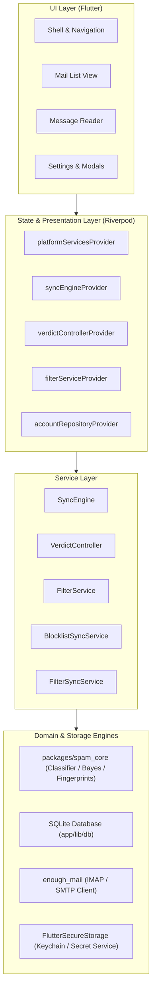
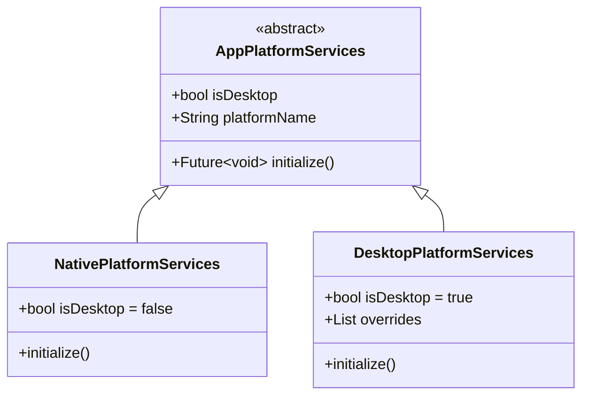
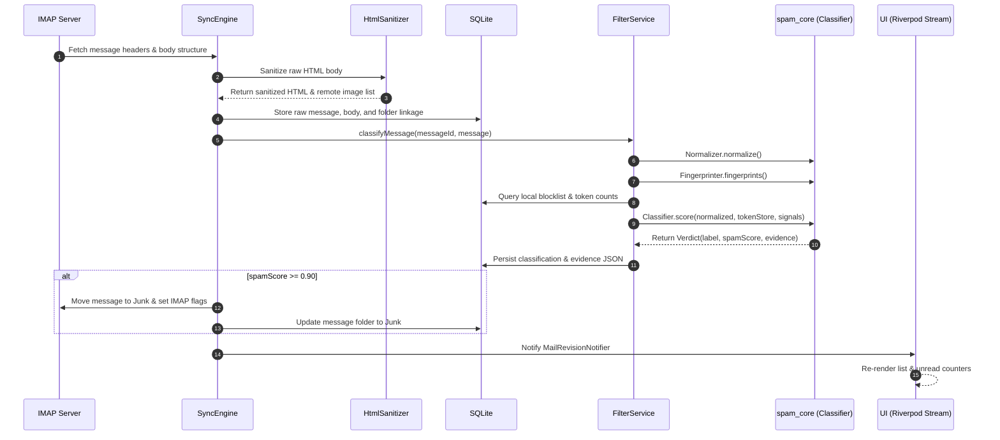
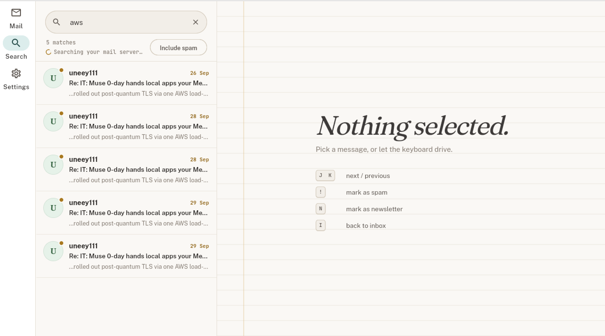

# Application Architecture

This document describes the architectural layout, core subsystems, platform split, and message processing pipeline in DataFortress Mail.

## Layer Overview

DataFortress Mail is structured into distinct architectural layers separating user interface components from state providers, background services, and underlying database/protocol libraries:

### Layer Responsibilities

- **UI Layer (`app/lib/ui/`)**: Built with Flutter and the Ledger Desk design system. Renders folder sidebars, message lists, sanitised email bodies, and configuration dialogs. Never connects directly to sockets or network clients.
- **Provider Layer (`app/lib/platform/`, `app/lib/filter/`, `app/lib/mail/`)**: Riverpod notifiers and providers managing reactive application state, folder selections, list density, account lists, and background sync triggers.
- **Service Layer (`app/lib/mail/`, `app/lib/filter/`, `app/lib/community/`, `app/lib/premium/`)**: Coordinates asynchronous domain workflows: IMAP synchronisation loops, verdict submission, token training, blocklist synchronization, and encrypted filter synchronization.
- **Domain & Engine Layer**:
  - `packages/spam_core`: Pure Dart spam engine containing the normalizer, tokenizer, Bayes classifier, heuristics, combiner, and fingerprint generators. Zero Flutter dependencies.
  - `app/lib/db/`: SQLite persistence for messages, folders, tokens, classifications, and community blocklist entries.
  - `enough_mail`: High-performance IMAP/SMTP transport library handling raw RFC-822 messages and socket encryption.
  - `FlutterSecureStorage`: Platform keychain abstraction storing sensitive mail passwords, OAuth2 tokens, and E2EE filter sync keys.

---

## Platform Services Split

The client supports five target platforms (Android, iOS, macOS, Windows, Linux). Native app stores and billing requirements diverge between mobile/macOS and traditional desktop operating systems. The application decouples these through `AppPlatformServices` (`app/lib/platform/platform_services.dart`):

### Native Platforms (iOS, Android, macOS)
Implemented in `NativePlatformServices` (`app/lib/platform/native_services.dart`):
- Uses native Firebase Auth bindings (`df_firebase_auth`).
- Uses native RevenueCat SDK (`df_revenuecat`) configured with `REVENUECAT_API_KEY` for in-app purchase receipts and entitlement tracking.
- Identifies as `isDesktop = false`.

### Desktop Platforms (Linux, Windows)
Implemented in `DesktopPlatformServices` (`app/lib/platform/desktop_services.dart`):
- Avoids native mobile store plugins that fail or crash on desktop operating systems.
- Uses Firebase Auth over REST and web-based Stripe checkout (`df_billing`).
- Overrides `dfRevenueCatIsProProvider` to false and maps `dfEffectivePremiumProvider` to listen directly to REST billing state.
- Identifies as `isDesktop = true`.

---

## Life of an Incoming Message

When an email arrives, it transitions through network synchronization, HTML sanitization, feature extraction, multi-signal scoring, database persistence, and optional server-side flag updates before appearing in the UI:

### Detailed Pipeline Steps

1. **IMAP Synchronization (`app/lib/mail/sync_engine.dart`)**:
   `SyncEngine` connects to the mail host using `enough_mail`, checks mailbox UID validity, and downloads new message envelopes and bodies.
2. **HTML Sanitization (`app/lib/mail/html_sanitizer.dart`)**:
   Before storage or display, HTML content is stripped of executable tags (`<script>`, `<object>`, `<iframe>`), inline event handlers, and `javascript:` URIs. Remote images (``) are replaced by default with lightweight inline SVG placeholders to prevent tracking beacons.
3. **Database Insertion (`app/lib/db/database.dart`)**:
   The message envelope, plain-text snippet, and sanitized HTML are saved to local SQLite tables (`messages`, `bodies`).
4. **Message Classification (`app/lib/filter/filter_service.dart`)**:
   A `spam_core.Message` instance is constructed from headers, text snippet, and HTML body. `FilterService` coordinates:
   - Feature normalization via `Normalizer.normalize`.
   - Fingerprint generation via `Fingerprinter.fingerprints`.
   - Blocklist lookup against local SQLite table `blocklist_entries`.
   - Execution of `Classifier.score`, evaluating Bayes token probabilities, authentication results, heuristics, and active community signals.
5. **Verdict Application & IMAP Actions**:
   The classification label (`spam`, `ham`, `newsletter`, `inbox`), spam probability score, and structured evidence list are stored in the `classifications` table.
   - If `spamScore >= 0.90`: The message is marked as spam on the IMAP server via `ImapFlagsManager.markSpam` and moved to the server's Junk folder.
   - If `0.60 <= spamScore < 0.90`: The message is tagged as spam in the local database and highlighted in the unsure band for review.
   **Search** (`app/lib/search/`, `SyncEngine.searchRemote`) is local first: an FTS5 index (`search_index`) answers immediately. After a typing pause the same query is translated to an IMAP `SEARCH` and run against each account's server, on the same queue and connection as sync (the account is synced first). Matches that are not stored yet (older mail, Archive and other unsynced folders; up to 25 per folder, newest first) are stored with the same writer sync uses, and the local query then shows them. Junk, Trash, Drafts and virtual folders are not searched, and imported mail is not scored. Only the user's mail server sees the query.

   

   Messages in the **Sent** folder are stored but skipped by this step entirely: they are never scored, never moved to Junk, and never train the filter. Servers that nest folders (Gmail's `[Gmail]/Sent Mail`) are covered by a recursive `LIST`; virtual folders such as Gmail's All Mail are neither listed nor synced.
6. **Attachments** (`app/lib/mail/attachments.dart`): see [Attachments](#attachments) below.
7. **Reactive UI Update**:
   `MailRevisionNotifier` triggers reactive Riverpod streams, rendering the updated message in the user's inbox, newsletter tab, or junk folder.

## Attachments

**Receiving.** Sync already fetches each message in full, so `_storeMessage` lists its files at no extra cost (`extractAttachments` in `app/lib/mail/attachments.dart`) and writes one `attachments` row per file: name, media type, IMAP part number and an estimated size. It counts parts with `Content-Disposition: attachment`, named non-text parts without a disposition (older mailers), named inline files and attached mails (`message/rfc822`). It does not count the text and HTML body or images embedded in the HTML by `Content-ID` (signature logos). `messages.has_attachments` comes from the same list.

The bytes are not stored. When the user taps a file in the reader (`AttachmentStrip`, `app/lib/ui/reader/attachment_strip.dart`), `SyncEngine.downloadAttachment` re-fetches the message on the shared sync connection, extracts the part and keeps it as a plain file under `<app support>/attachments/<account id>/<hash>/<file name>`; later opens use that copy. Removing the account deletes its folder. Two rules keep the download honest:

- **The stored UID is not trusted.** A message moved to Junk (by the filter or by the user) keeps the UID it had in the old folder, which names nothing, or a different message, in the new one. The re-fetched copy must carry the stored `Message-ID`; if the UID misses, the folder is searched for that header; if that also fails the download is an error, never another message's bytes.
- **File names come from the sender.** `safeFileName` strips directories, control and reserved characters, leading dots and over-long names before a name touches the disk. Files a system would run when opened (`.exe`, `.sh`, `.bat`, `.jar`, `.desktop`, macro-enabled Office files, and similar; see `isRunnableFileName`) are never handed to the operating system: the reader explains and offers "Save as…" instead.

Mail synced before the table existed is filled in on first view (`SyncEngine.attachmentsOf`).

**Sending.** The compose window attaches files with `file_picker` (all five platforms; the bytes are read only when the mail is sent). `buildOutgoingMessage` (`app/lib/mail/smtp_service.dart`) produces `multipart/alternative` as before when there are no files, and `multipart/mixed` (the text pair plus one base64 part per file) when there are. The total is capped at 18 MB (`maxOutgoingAttachmentBytes`), because base64 adds a third and the common 25 MB server limit counts the encoded size; a server with a lower limit answers with its own error, which the window shows. A forward starts with the original's attachments, downloaded as described above when the forward is sent. While a send runs the Send button is disabled, so a large upload cannot be sent twice.

Open and save use `open_filex` and `file_picker`: the system's default app on iOS, Android, macOS, Windows and Linux (`xdg-open`), and a save dialog on all of them. Nothing about attachments goes to the DataFortress backend, and the spam filter does not read attachment content.
