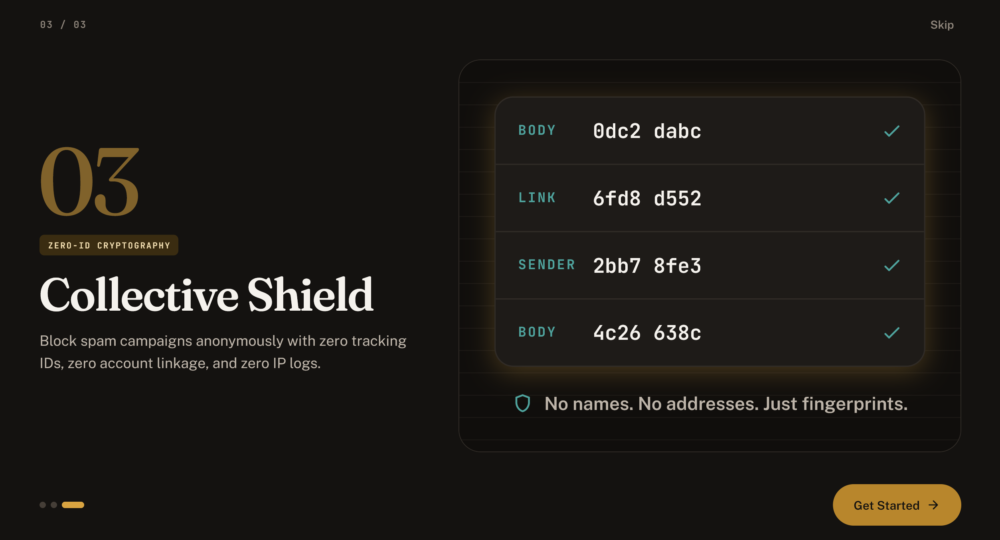
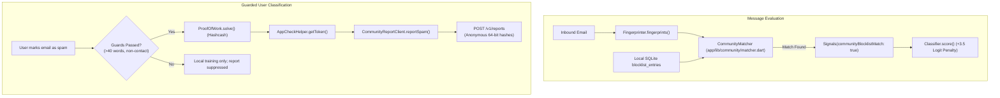

# Community Spam Sharing

DataFortress Mail features an anonymous, privacy-preserving community spam defense network. When users classify emails as spam, the client generates cryptographic representations that help protect other users across the network without disclosing email contents, sender identities, or recipient addresses.

For the formal privacy architecture and cryptographic definitions, see the [Privacy Specification](privacy-spec.md).

## Client Workflow Overview

DataFortress introduces an anonymous collective defense model that turns private individual spam reports into network-wide protection:

The community defense loop operates continuously on the client device through local fingerprint generation, guarded reporting, and periodic blocklist delta synchronization:

---

## Fingerprint Generation

When inspecting or reporting an email, `Fingerprinter` (`packages/spam_core/lib/src/fingerprint.dart`) extracts three distinct non-invertible fingerprint types:

1. **Body Bands (MinHash 32 / LSH 8x4)**:
   - Evaluates normalized text words of length $\ge 2$.
   - Generates overlapping word 3-shingles across the message.
   - Computes MinHash values using 32 independent pseudo-random 64-bit seeds via 64-bit FNV-1a.
   - Combines the 32 hashes into 8 Locality Sensitive Hashing (LSH) bands of 4 rows each.
   - Enables detection of structurally similar mass phishing or scam campaigns even when spammers randomize individual sentences.
2. **URL Hashes**:
   - Parses all hyperlinks found in HTML or plain-text bodies.
   - Computes 64-bit hashes for both the effective top-level domain plus one level (`eTLD+1`) and the host plus first path segment (`host/path1`).
3. **Sender Domain Hash**:
   - Computes a 64-bit hash of the sender's domain.
   - Strictly omitted for public freemail providers (e.g., `gmail.com`, `yahoo.com`, `outlook.com`) to prevent false-positive domain blacklisting.

---

## Client Safeguards & Anti-Abuse

To prevent accidental privacy leakage and protect the backend from automated denial-of-service or poisoning attacks, the client implements strict operational safeguards:

### Content Privacy Guards
- **Short Body Suppression**: Messages with bodies containing fewer than 40 words produce zero body bands. This ensures that short personal notes (e.g., "See you at 5", "Thanks for the update") can never be fingerprinted or matched.
- **Freemail Protection**: Domains listed in `packages/spam_core/lib/src/freemail_domains.dart` never produce sender domain hashes.
- **Trusted Contact Exemption**: Emails from addresses present in the local `contacts` table are exempt from automated community reporting.

### Network Anti-Abuse
- **Proof-of-Work (`app/lib/community/pow.dart`)**:
  Before transmitting a report to `POST /v1/reports`, the client must solve a Hashcash-style SHA-256 challenge. It computes a nonce such that `sha256(challenge + ":" + nonce)` exhibits the required leading zero bits (default 8 bits), creating an intentional CPU cost per submission.
- **App Check Attestation (`app/lib/community/app_check.dart`)**:
  On supported platforms, reports include an app attestation token confirming the request originates from an authentic, unmodified client binary.
- **Zero-Identifier Transport (`app/lib/community/report_client.dart`)**:
  The HTTP client (`CommunityReportClient`) deliberately strips all session cookies, Firebase ID tokens, device identifiers, and platform metadata from community API requests.

---

## Local Blocklist Synchronization

Clients download and locally evaluate community intelligence without submitting search queries:

- **Full Snapshot Download (`BlocklistSyncService`)**: On initial startup or if the local database is reset, the client downloads the active snapshot (`GET /v1/blocklist/snapshot`) and populates `blocklist_entries`.
- **Periodic Delta Sync**: A background timer runs every 6 hours (`GET /v1/blocklist/delta?since=<version>`), retrieving incremental additions and revocations.
- **Local Matching (`CommunityMatcher`)**:
  During message classification, incoming fingerprints are checked locally against `blocklist_entries`:
  - A matching URL hash triggers a match.
  - A matching sender domain hash triggers a match.
  - Two or more matching LSH body bands (out of 8) constitute a match.
  A match applies a +3.5 logit penalty in the classifier combiner, flagging the email as high-probability spam.

---

## Opt-Out Controls in the UI

Community sharing is opt-in/opt-out and controllable by the user at all times:

1. **Global Settings Switch (`app/lib/ui/settings/sharing_tile.dart`)**:
   Located in **Settings → Community Sharing**. The switch toggles the `share_spam_fingerprints` preference in local SQLite settings. Toggling this off immediately stops all outgoing report submissions and background blocklist synchronizations.
2. **First-Time Verdict Notice (`app/lib/ui/reader/reader_view.dart`)**:
   The first time a user marks an email as spam, an explicit sharing notice banner (`SharingNoticeBanner`) appears above the message reader. The banner informs the user that anonymous cryptographic fingerprints will be shared to protect the network, offering a one-tap **Turn Off** option and a **Learn More** dialog.
