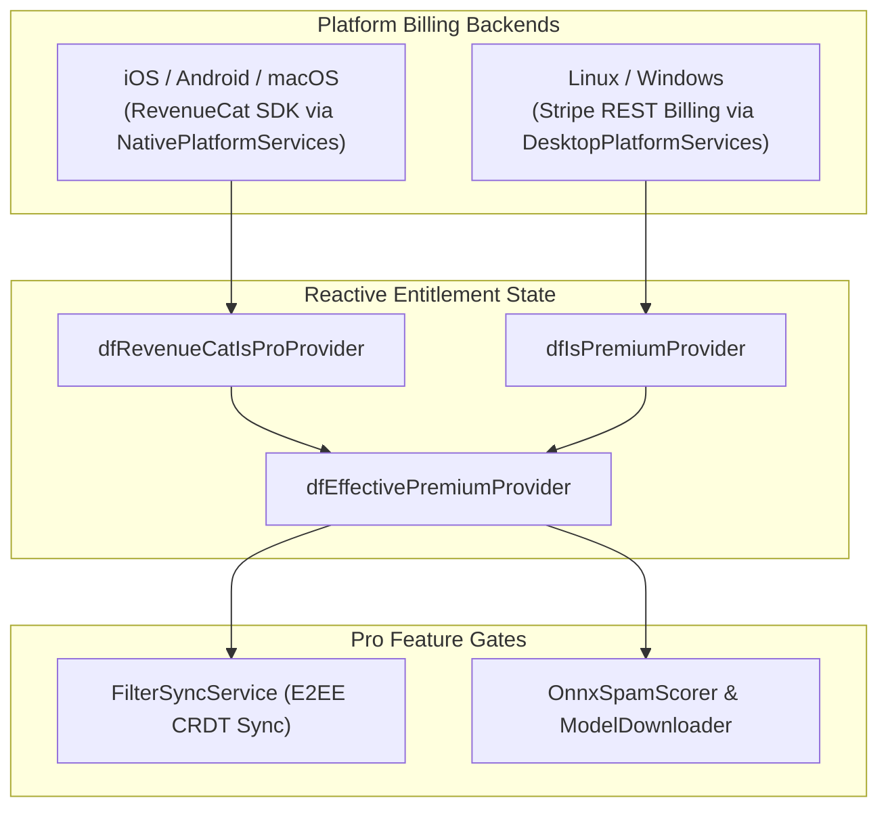
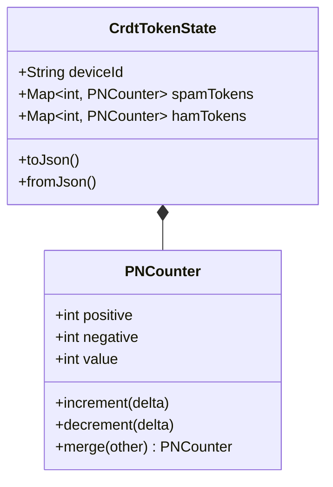
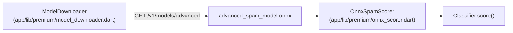

# Premium (Pro) Architecture

DataFortress Mail follows an open-core model. All core email client features, the local Robinson-Fisher Bayes filter, heuristics, and anonymous community blocklist protection are 100% free and open source.

DataFortress Pro introduces multi-device cryptographic synchronization and advanced on-device machine learning models. This document describes the client-side architecture of Pro features.

## Entitlement Gating

Pro features are gated on the client through Riverpod providers responding to platform-specific billing systems:

### Platform Implementations
- **Native Platforms (`NativePlatformServices` in `app/lib/platform/native_services.dart`)**:
  Configured with `REVENUECAT_API_KEY`. Listens to `dfRevenueCatIsProProvider` to check the `pro` entitlement.
- **Desktop Platforms (`DesktopPlatformServices` in `app/lib/platform/desktop_services.dart`)**:
  Linux and Windows builds bypass mobile store SDKs. `DesktopPlatformServices` provides provider overrides that map `dfEffectivePremiumProvider` to `dfIsPremiumProvider`, querying the web billing checkout status.
- **Application State**:
  Controllers (such as `VerdictController`) and UI widgets observe `ref.watch(dfEffectivePremiumProvider)` to determine whether Pro capabilities should activate.

---

## End-to-End Encrypted (E2EE) Filter Sync

Pro users can synchronize their trained Bayes token frequencies across multiple personal devices (e.g., laptop and phone) without exposing training history to the sync server.

### Cryptographic Foundation (`app/lib/premium/sync_key.dart`)
- **256-bit AES-GCM**: Token state payloads are serialized to JSON, encrypted with 256-bit AES in Galois/Counter Mode (GCM) using a unique 12-byte initialization vector (IV) per upload.
- **Hardware Isolation**: The master sync key is generated using `Random.secure()` and stored in hardware-backed keystores (`FlutterSecureStorage`). It is never transmitted across the network.
- **Key Recovery**: Users can export or import the key across devices via a 24-word recovery phrase or raw hexadecimal string.

### State-Based CRDT PN-Counters (`app/lib/premium/crdt_counters.dart`)
Filter training involves both positive adjustments (marking an email as spam) and negative corrections (undoing a false positive or moving an email to inbox). To reconcile multi-device updates without race conditions or server-side merges, the client models token counts as Conflict-free Replicated Data Types (CRDTs):

- Each token maintains a Positive-Negative counter: `PNCounter(positive: P, negative: N)`.
- The effective token count is evaluated as $V = P - N$.
- State-based CRDT merging calculates the component-wise supremum:
  $$\text{merge}(C_1, C_2) = \text{PNCounter}\Big(\max(P_1, P_2), \max(N_1, N_2)\Big)$$

### Sync Protocol (`app/lib/premium/filter_sync.dart`)
1. **Debounced Trigger**: When the user reclassifies messages, `VerdictController` schedules an encrypted state upload with a 1-minute debounce timer.
2. **Device State Upload**: The client serializes its local `CrdtTokenState`, encrypts it with the local 256-bit key, and uploads the ciphertext to `PUT /v1/sync/blobs/<deviceSlot>`.
3. **Multi-Device Pull**: The client queries `GET /v1/sync/blobs/<slot>` for all other registered device slots, decrypts the ciphertext payloads using the shared sync key, and applies the remote CRDT state to the local `TokenStoreDrift`.

---

## On-Device Neural Scorer (ONNX)

Pro includes support for an on-device neural transformer classifier designed to augment traditional Robinson-Fisher Bayes scoring on ambiguous messages:

### Model Distribution (`app/lib/premium/model_downloader.dart`)
- `ModelDownloader.downloadModelIfEntitled()` queries the backend API (`GET /v1/models/advanced`) to retrieve a secure, signed model distribution URL.
- Downloads the serialized ONNX weights file (`advanced_spam_model.onnx`) directly to the local application documents directory.

### On-Device Inference (`app/lib/premium/onnx_scorer.dart`)
!!! note "Current Implementation Status"
    In the current codebase, `OnnxSpamScorer.runtimeAvailable` is set to `false`. Real-time neural inference requires a licence-clean open-weight model and a validated multi-platform ONNX runtime library (`fonnx` or `flutter_onnxruntime`).
    
    Until an inference runtime is wired in, `OnnxSpamScorer.score()` returns `null`. The signal combiner treats `null` as "no neural signal", preventing artificial noise from altering spam scores.
