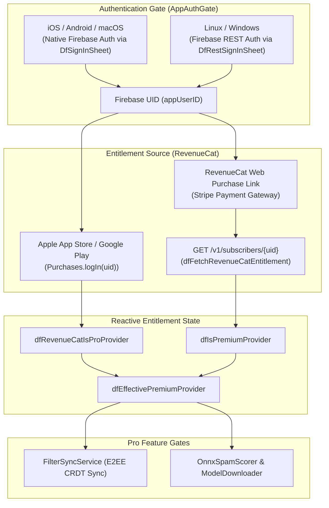
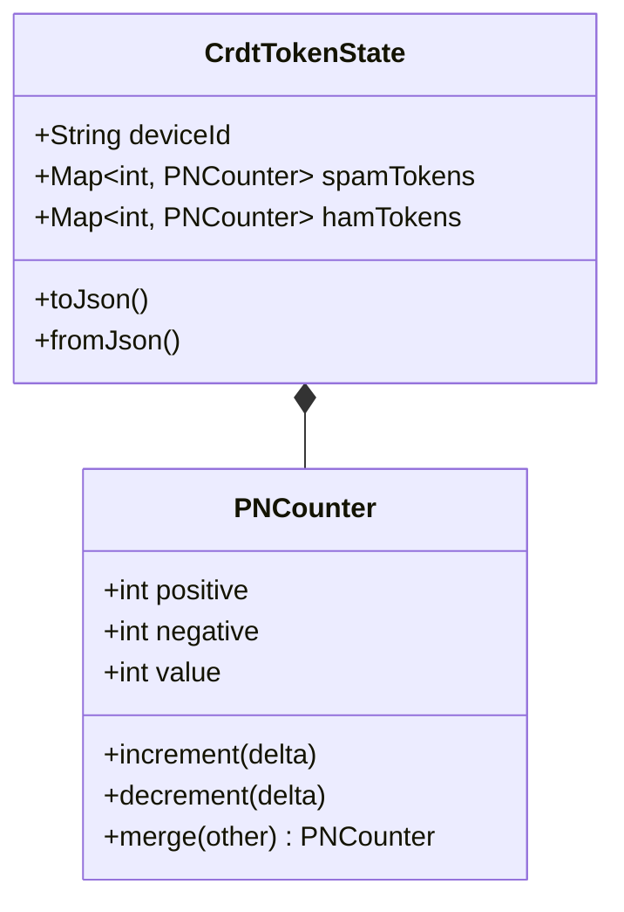
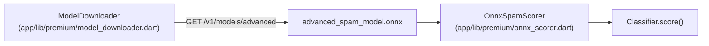

# Premium (Pro) Architecture

DataFortress Mail follows an open-core model. All core email client features, the local Robinson-Fisher Bayes filter, heuristics, and anonymous community blocklist protection are 100% free and open source.

DataFortress Pro introduces multi-device cryptographic synchronization and advanced on-device machine learning models. This document describes the client-side architecture of Pro features.

## Entitlement Gating & Pro-Auth Architecture

DataFortress Mail adheres to a strict principle: **the free app stays 100% login-free**. Users never need to register an account or sign in to connect their IMAP/SMTP mail accounts, run on-device Bayesian spam filtering, or sync community blocklists.

Authentication is introduced **only when the user upgrades to Pro** (or explicitly signs in through Settings → Account). Pro features are gated on the client through Riverpod providers responding to platform-specific billing systems, unified by a single identity:

- **Identity = Firebase UID on all platforms**: The Firebase user ID (`uid`) is assigned as the RevenueCat `appUserID`. This single identifier allows a subscription purchased on mobile to unlock desktop features and vice versa.
- **RevenueCat is the single source of truth for "is Pro"**: Stripe acts exclusively as the payment gateway behind RevenueCat Web Billing.
- **Sign-in gate before upgrade**: Upgrading to Pro requires authentication *before* presenting any paywall or checkout link.

### Platform Implementations

#### 1. Native Platforms (`NativePlatformServices` in `app/lib/platform/native_services.dart`)
- **Initialization**: Configured with `FIREBASE_API_KEY`, `FIREBASE_APP_ID_ANDROID`, `FIREBASE_APP_ID_IOS`, `FIREBASE_PROJECT_ID`, `FIREBASE_MESSAGING_SENDER_ID`, and `FIREBASE_AUTH_DOMAIN` via `firebase_options_from_env.dart`. RevenueCat is configured with `REVENUECAT_API_KEY_IOS` / `REVENUECAT_API_KEY_ANDROID` (with `REVENUECAT_API_KEY` as fallback).
- **Auth Sync**: Listens to `FirebaseAuth.instance.authStateChanges()`. When a user signs in, it automatically invokes `DfRevenueCat.logIn(user.uid)`. When signed out, it calls `DfRevenueCat.logOut()`.
- **Entitlement**: Listens to `dfRevenueCatIsProProvider` to check the `pro` entitlement.

#### 2. Desktop Platforms (`DesktopPlatformServices` in `app/lib/platform/desktop_services.dart`)
- **Initialization**: Configured with `FIREBASE_WEB_API_KEY`, `RC_WEB_PURCHASE_LINK`, and `RC_WEB_PUBLIC_API_KEY`. Native store SDKs and native Firebase bindings are completely bypassed.
- **REST Auth**: Provides `dfFirebaseRestAuthProvider` initialized with `FirebaseRestAuth(apiKey: webApiKey)`.
- **REST Entitlement Fetch**: Overrides `dfSubscriptionFetcherProvider` with an implementation that reads the current REST user's `uid` and calls `dfFetchRevenueCatEntitlement(appUserId: uid, publicApiKey: rcWebPublicKey, entitlementId: 'pro')`.
- **Entitlement**: Maps `dfEffectivePremiumProvider` to `dfIsPremiumProvider`, which caches and periodically re-fetches the subscriber entitlement snapshot from RevenueCat.

#### 3. Upgrade Flow (`AppCheckout` in `app/lib/ui/premium/app_checkout.dart`)
When the user taps **Upgrade to Pro** (e.g. from the upsell sheet or Settings):
1. **Configuration Check**: Verifies whether Firebase is configured. In an unconfigured build, it informs the user that checkout is unavailable (`UiStrings.checkoutUnavailable`) and returns `DfPaywallResult.notPresented`.
2. **Auth Gate (`AppAuthGate.ensureSignedIn`)**: Checks if the user is already authenticated.
   - If not signed in, presents the platform sign-in sheet (`DfSignInSheet` on native; `DfRestSignInSheet` on desktop).
   - If the user cancels or dismisses sign-in, `AppCheckout` aborts immediately with `DfPaywallResult.cancelled` without showing any payment UI.
3. **Checkout Presentation**:
   - **Native**: Calls `DfRevenueCat.logIn(uid)` to bind the Firebase identity, then displays the RevenueCat paywall via `DfPaywallLauncher.show(context)`. Only `purchased` or `restored` results grant access.
   - **Desktop**: Calls `DfWebPurchaseLink.open(baseLink: rcWebPurchaseLink, appUserId: uid)` to open the RevenueCat Web Purchase Link (hosted Stripe checkout) in the user's default browser with the percent-encoded UID. It returns `DfPaywallResult.notPresented` — **the client never assumes purchase from a browser launch**. The entitlement is fetched and verified via the REST endpoint when the app resumes or the fetcher runs.

#### 4. Settings Account Tile (`AccountTile` in `app/lib/ui/settings/account_tile.dart`)
- Hidden completely when Firebase environment defines are missing.
- When signed in, displays the authenticated email address and a "Sign out" button. Signing out clears auth state, invalidates cached entitlements, and logs out of RevenueCat (`DfRevenueCat.logOut()`).
- When signed out, displays a "Sign in" button to open the platform's authentication sheet.

#### 5. Application State
Controllers (such as `VerdictController`) and UI widgets observe `ref.watch(dfEffectivePremiumProvider)` to determine whether Pro capabilities should activate.

---

## End-to-End Encrypted (E2EE) Filter Sync

Pro users can synchronize their trained Bayes token frequencies across multiple personal devices (e.g., laptop and phone) without exposing training history to the sync server.

### Cryptographic Foundation (`app/lib/premium/sync_key.dart`)
- **256-bit AES-GCM**: Token state payloads are serialized to JSON, encrypted with 256-bit AES in Galois/Counter Mode (GCM) using a unique 12-byte initialization vector (IV) per upload.
- **Hardware Isolation**: The master sync key is generated using `Random.secure()` and stored in hardware-backed keystores (`FlutterSecureStorage`). It is never transmitted across the network.
- **Key Recovery**: Users can export or import the key across devices via a 24-word recovery phrase or raw hexadecimal string.

### State-Based CRDT PN-Counters (`app/lib/premium/crdt_counters.dart`)
Filter training involves both positive adjustments (marking an email as spam) and negative corrections (undoing a false positive or moving an email to inbox). To reconcile multi-device updates without race conditions or server-side merges, the client models token counts as Conflict-free Replicated Data Types (CRDTs):

- Each token maintains a Positive-Negative counter: `PNCounter(positive: P, negative: N)`.
- The effective token count is evaluated as $V = P - N$.
- State-based CRDT merging calculates the component-wise supremum:
  $$\text{merge}(C_1, C_2) = \text{PNCounter}\Big(\max(P_1, P_2), \max(N_1, N_2)\Big)$$

### Sync Protocol (`app/lib/premium/filter_sync.dart`)
1. **Debounced Trigger**: When the user reclassifies messages, `VerdictController` schedules an encrypted state upload with a 1-minute debounce timer.
2. **Device State Upload**: The client serializes its local `CrdtTokenState`, encrypts it with the local 256-bit key, and uploads the ciphertext to `PUT /v1/sync/blobs/<deviceSlot>`.
3. **Multi-Device Pull**: The client queries `GET /v1/sync/blobs/<slot>` for all other registered device slots, decrypts the ciphertext payloads using the shared sync key, and applies the remote CRDT state to the local `TokenStoreDrift`.

---

## On-Device Neural Scorer (ONNX)

Pro includes support for an on-device neural transformer classifier designed to augment traditional Robinson-Fisher Bayes scoring on ambiguous messages:

### Model Distribution (`app/lib/premium/model_downloader.dart`)
- `ModelDownloader.downloadModelIfEntitled()` queries the backend API (`GET /v1/models/advanced`) to retrieve a secure, signed model distribution URL.
- Downloads the serialized ONNX weights file (`advanced_spam_model.onnx`) directly to the local application documents directory.

### On-Device Inference (`app/lib/premium/onnx_scorer.dart`)
!!! note "Current Implementation Status"
    In the current codebase, `OnnxSpamScorer.runtimeAvailable` is set to `false`. Real-time neural inference requires a licence-clean open-weight model and a validated multi-platform ONNX runtime library (`fonnx` or `flutter_onnxruntime`).
    
    Until an inference runtime is wired in, `OnnxSpamScorer.score()` returns `null`. The signal combiner treats `null` as "no neural signal", preventing artificial noise from altering spam scores.
