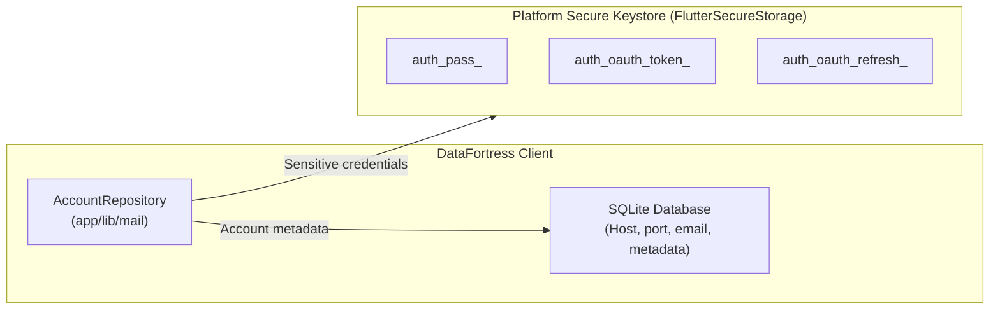

# Privacy Model & Data Protection

DataFortress Mail is engineered around the principle that personal email data must remain private and reside strictly on user-controlled hardware. This document outlines the application's threat boundaries, data flow rules, sanitization architecture, and credential protection.

## Data Flow: What Leaves the Device

The following table itemizes what data crosses network boundaries versus what remains exclusively on the local client device:

| Data Element | Network Destination | Protocol & Security | Conditions |
|---|---|---|---|
| **Raw email body (plain text & HTML)** | *Never leaves device* | N/A | Kept in local SQLite database |
| **Search index (copy of subject, sender, recipients and body text)** | *Never leaves device* | N/A | FTS5 table in the local SQLite database |
| **Search queries** | Sent only to *your own* mail server (IMAP `SEARCH`) | Your IMAP host, over the account's existing connection | Never sent to the DataFortress backend or the community. Queries with `is:spam` / `is:newsletter` are not sent at all. |
| **Email headers (Subject, From, To, CC)** | *Never leaves device* | N/A | Kept in local SQLite database |
| **Email attachments** | Fetched from, and attached mail sent through, *your own* mail server only | Your IMAP / SMTP host, over the account's existing connection | A received file is downloaded when you open or save it and then kept as a plain file in the app's own storage until you remove the account. Never sent to the DataFortress backend or the community; the spam filter does not read attachment content. |
| **Account credentials (passwords, tokens)** | *Never leaves device* | N/A | Stored in OS-level hardware keystore |
| **Contacts & address book** | *Never leaves device* | N/A | Kept in local SQLite database |
| **Bayes word dictionaries & frequencies** | *Never leaves device* | N/A | Kept in local SQLite database |
| **E2EE sync master key (256-bit)** | *Never leaves device* | N/A | Stored in OS-level hardware keystore |
| **IMAP/SMTP mailbox traffic** | User's configured mail server | TLS 1.2+ encrypted socket | Required for email sync & sending |
| **Anonymous spam fingerprints** | Hosted community API | HTTPS / Zero-knowledge payload | Only when community sharing is enabled |
| **Encrypted CRDT token blobs** | Hosted sync storage | HTTPS / 256-bit AES-GCM encrypted | Only for Pro users with E2EE sync enabled |
| **Model weights download** | Hosted model distribution | HTTPS GET | Only for Pro users with neural model enabled |
| **Store receipts / subscription tokens** | RevenueCat / Stripe / App Store | HTTPS | Only during Pro purchase & verification |

---

## HTML Sanitization Engine

Untrusted email HTML frequently contains tracking scripts, embedded exploits, or web beacons designed to fingerprint recipients. The application sanitizes all incoming HTML through `HtmlSanitizer` (`app/lib/mail/html_sanitizer.dart`) before rendering:

### Implemented Sanitization Rules

1. **Dangerous Tag Removal**:
   Completely strips dangerous executable and layout tags, including their inner contents:
   - `<script>` and `<style>`
   - `<iframe>` and `<frame>`
   - `<object>`, `<embed>`, and `<applet>`
   - `<form>` inputs and action buttons
   Both standard paired tags (`<script>...</script>`) and self-closing variants (`<script/>`) are stripped via regular expressions.
2. **Inline Event Handler Elimination**:
   Strips all inline `on*` JavaScript event handlers from remaining tags (e.g., `onclick`, `onload`, `onerror`, `onmouseover`).
3. **Pseudo-Protocol Neutralization**:
   Identifies and neutralizes `href` attributes attempting JavaScript execution (`href="javascript:..."`), replacing them with benign anchors (`href="#"`).

---

## Remote Image Blocking by Default

Remote images (often single-pixel transparent GIFs or uniquely parameterized image URLs) are widely used by senders to verify when an email was opened, reveal the recipient's public IP address, and record user-agent metadata.

- **Default Stance**: Remote image loading is **disabled by default** across all incoming messages.
- **Replacement Mechanism**: `HtmlSanitizer` replaces remote `` tags (`http://` or `https://`) with an inert inline SVG placeholder:
  ```html
  <rect width='24' height='24' fill='%23e4ded4'/></svg>" alt="[Image blocked]" />
  ```
- **User Control**: The user may explicitly reveal remote images on a per-message basis, or whitelist trusted senders via the `always_allow_images` setting in the local `contacts` table.

---

## Credential Storage

Email accounts require storing access credentials (either plain IMAP/SMTP passwords or OAuth2 access/refresh tokens). DataFortress Mail never stores plaintext credentials in SQLite databases or shared configuration files.



All credentials are delegated to `FlutterSecureStorage` (`app/lib/mail/account_repository.dart`), backed by native operating system keystores:
- **macOS / iOS**: Apple Keychain Services.
- **Android**: Android Keystore with EncryptedSharedPreferences.
- **Linux**: Secret Service API via `libsecret` (GNOME Keyring / KWallet).
- **Windows**: Windows Credential Manager.

---

## E2EE Sync Key Independence

For Pro users synchronizing filter training state across multiple devices, synchronization relies on client-side 256-bit AES-GCM encryption (`SyncKeyManager` in `app/lib/premium/sync_key.dart`).

!!! important "Cryptographic Key Isolation"
    The 256-bit encryption key is **never derived from user authentication credentials** (such as Firebase UID, account passwords, or master login tokens).

- **Generation**: The sync key is generated locally using `Random.secure()`, producing 32 cryptographically random bytes.
- **Storage**: The raw key is written exclusively to platform hardware secure storage under key `e2ee_filter_sync_key_256`.
- **Zero-Knowledge Backend**: The hosted backend storage server receives and stores only encrypted ciphertext blobs. The server never holds, sees, or has the mathematical means to derive the encryption key.
- **Recovery & Transfer**: Cross-device key exchange is performed manually by the user via a 24-word recovery phrase or direct hex export.

For full technical specifications on the anonymous community sharing protocol, see the [Privacy Specification](privacy-spec.md).
