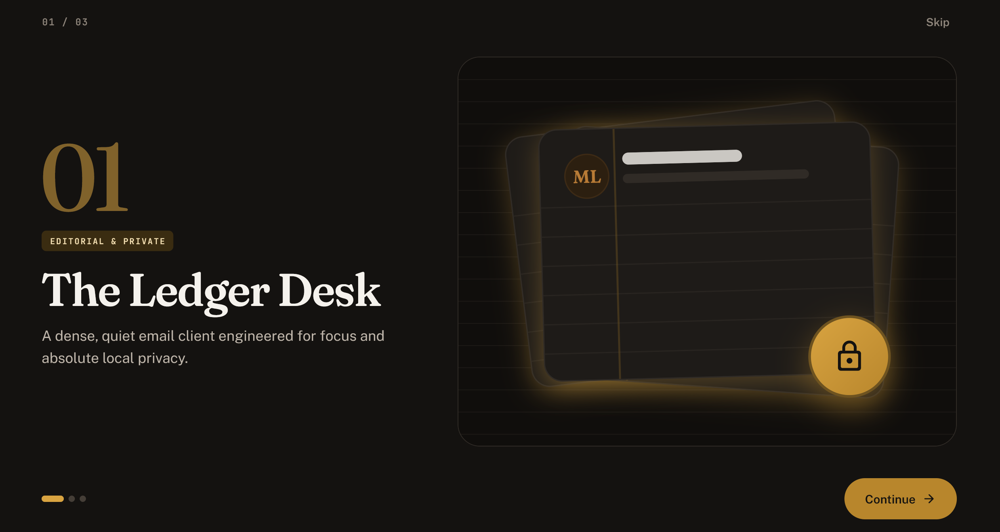
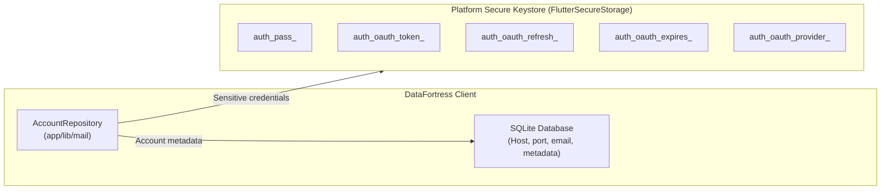

# Privacy Model & Data Protection

DataFortress Mail is engineered around the principle that personal email data must remain private and reside strictly on user-controlled hardware. This document outlines the application's threat boundaries, data flow rules, sanitization architecture, and credential protection.



## Account & Identity Model: Free vs Pro

DataFortress Mail makes a strict separation between core email functionality and cloud-backed Pro subscriptions:

### 1. The Free App Has No Account
The free application is completely **login-free and account-free**:
- You never create an account with DataFortress to use the mail client.
- Your email accounts connect directly from your device to your mail server (IMAP/SMTP) using credentials stored strictly in your operating system's hardware keystore.
- Bayesian spam filtering, heuristics, token training, and search indexing execute 100% locally on your machine.
- Anonymous community blocklist sync and threat reporting communicate with zero-knowledge, pseudorandom hashes without any user identifier, email, or device ID.

### 2. Pro Identity Architecture
Subscribing to DataFortress Pro introduces an account strictly for entitlement verification and encrypted multi-device synchronization:
- **Firebase UID is the Subscription ID**: When upgrading to Pro, you sign in or create an account with Firebase Auth (email/password). Your Firebase User ID (`uid`) serves as the unique subscriber identifier.
- **Cross-Platform Entitlement**: The Firebase UID is passed as the RevenueCat `appUserID`. Because the same UID identifies you across platforms, purchasing Pro on iOS or Android unlocks Pro on Linux and Windows, and vice versa.
- **Sign-In Gate Before Payment**: The client enforces sign-in *prior* to opening any paywall or checkout link. Payment is never initiated anonymously, ensuring your subscription is always tied to your account.

### 3. Privacy Boundaries: What Cloud Providers See

| Service | What It Sees | What It NEVER Sees |
|---|---|---|
| **Firebase Auth** | Email address, password hash, Firebase UID, account creation/sign-in timestamps, and IP address during authentication. | Email messages, subjects, bodies, headers, attachments, contacts, IMAP/SMTP passwords, or spam filter training data. |
| **RevenueCat** | Firebase UID (as `appUserID`), subscription status, active entitlements (`pro`), purchase dates, renewal/expiration timestamps, store transaction identifiers, and platform OS. | Email messages, bodies, mail credentials, Bayes tokens, or contacts. (Email address is only seen if optionally supplied to the checkout link). |
| **Stripe** (Web Billing gateway behind RevenueCat) | Payment card details, billing address, customer name, transaction amounts, and Stripe customer/charge IDs. | Email content, mail account passwords, Bayes filter tokens, or mailbox usage. |
| **App Store / Google Play** (Mobile Store IAP) | Apple ID or Google account, in-app purchase transaction and payment info. | Email content, mail credentials, or spam filter tokens. |
| **DataFortress Sync Server** | Authenticated Firebase UID and 256-bit AES-GCM encrypted ciphertext token blobs (`PUT /v1/sync/blobs/<slot>`). | Encryption keys (AES-256 key generated on device with `Random.secure()`), unencrypted Bayes tokens, email content, or personal identifiers. |

---

## Data Flow: What Leaves the Device

The following table itemizes what data crosses network boundaries versus what remains exclusively on the local client device:

| Data Element | Network Destination | Protocol & Security | Conditions |
|---|---|---|---|
| **Raw email body (plain text & HTML)** | *Never leaves device* | N/A | Kept in local SQLite database |
| **Search index (copy of subject, sender, recipients and body text)** | *Never leaves device* | N/A | FTS5 table in the local SQLite database |
| **Search queries** | Sent only to *your own* mail server (IMAP `SEARCH`) | Your IMAP host, over the account's existing connection | Never sent to the DataFortress backend or the community. Queries with `is:spam` / `is:newsletter` are not sent at all. |
| **Email headers (Subject, From, To, CC)** | *Never leaves device* | N/A | Kept in local SQLite database |
| **Email attachments** | Fetched from, and attached mail sent through, *your own* mail server only | Your IMAP / SMTP host, over the account's existing connection | A received file is downloaded when you open or save it and then kept as a plain file in the app's own storage until you remove the account. Never sent to the DataFortress backend or the community; the spam filter does not read attachment content. |
| **Account credentials (passwords, tokens)** | *Never leaves device* | N/A | Stored in OS-level hardware keystore |
| **Contacts & address book** | *Never leaves device* | N/A | Kept in local SQLite database |
| **Bayes word dictionaries & frequencies** | *Never leaves device* | N/A | Kept in local SQLite database |
| **E2EE sync master key (256-bit)** | *Never leaves device* | N/A | Stored in OS-level hardware keystore |
| **IMAP/SMTP mailbox traffic** | User's configured mail server | TLS 1.2+ encrypted socket | Required for email sync & sending |
| **Auto-unsubscribe (RFC 8058 One-Click)** | Sender's published unsubscribe URL | HTTPS POST (port 443, no redirects) | Fired when marking email as spam (if authenticated sender and setting enabled, after 10 s undo window) or manual Unsubscribe button. Never sent to DataFortress backend. |
| **Auto-unsubscribe (RFC 2369 mailto)** | User's configured mail server to sender's unsubscribe address | TLS 1.2+ encrypted SMTP | Sent from user's account when RFC 8058 is unavailable. Never sent to DataFortress backend. |
| **Anonymous spam fingerprints** | Hosted community API | HTTPS / Zero-knowledge payload | Only when community sharing is enabled; free app has no user ID attached |
| **User authentication credentials (email/password)** | Firebase Auth | TLS 1.3 / HTTPS | Only for Pro users when signing in or creating an account; free app sends nothing |
| **Subscriber identity & entitlement state** | RevenueCat | HTTPS REST / SDK | RevenueCat tracks `pro` entitlement under Firebase UID; free app sends nothing |
| **Web payment details** | Stripe (via RevenueCat Web Billing) | HTTPS / PCI-DSS Compliant | Only on desktop web checkout when user purchases a subscription |
| **Encrypted CRDT token blobs** | Hosted sync storage | HTTPS / 256-bit AES-GCM encrypted | Only for Pro users with E2EE sync enabled |
| **Model weights download** | Hosted model distribution | HTTPS GET | Only for Pro users with neural model enabled |
| **Store receipts / subscription tokens** | RevenueCat / App Store / Play Store | HTTPS | Only during native Pro purchase & verification |

---

## HTML Sanitization Engine

Untrusted email HTML frequently contains tracking scripts, embedded exploits, or web beacons designed to fingerprint recipients. The application sanitizes all incoming HTML through `HtmlSanitizer` (`app/lib/mail/html_sanitizer.dart`) before rendering:

### Implemented Sanitization Rules

1. **Dangerous Tag Removal**:
   Completely strips dangerous executable and layout tags, including their inner contents:
   - `<script>` and `<style>`
   - `<iframe>` and `<frame>`
   - `<object>`, `<embed>`, and `<applet>`
   - `<form>` inputs and action buttons
   Both standard paired tags (`<script>...</script>`) and self-closing variants (`<script/>`) are stripped via regular expressions.
2. **Inline Event Handler Elimination**:
   Strips all inline `on*` JavaScript event handlers from remaining tags (e.g., `onclick`, `onload`, `onerror`, `onmouseover`).
3. **Pseudo-Protocol Neutralization**:
   Identifies and neutralizes `href` attributes attempting JavaScript execution (`href="javascript:..."`), replacing them with benign anchors (`href="#"`).

---

## Remote Image Blocking by Default

Remote images (often single-pixel transparent GIFs or uniquely parameterized image URLs) are widely used by senders to verify when an email was opened, reveal the recipient's public IP address, and record user-agent metadata.

- **Default Stance**: Remote image loading is **disabled by default** across all incoming messages.
- **Replacement Mechanism**: `HtmlSanitizer` replaces remote `` tags (`http://` or `https://`) with an inert inline SVG placeholder:
  ```html
  <rect width='24' height='24' fill='%23e4ded4'/></svg>" alt="[Image blocked]" />
  ```
- **User Control**: The user may explicitly reveal remote images on a per-message basis, or whitelist trusted senders via the `always_allow_images` setting in the local `contacts` table.

---

## Credential Storage

Email accounts require storing access credentials (either plain IMAP/SMTP passwords or OAuth2 access/refresh tokens). DataFortress Mail never stores plaintext credentials in SQLite databases or shared configuration files.



All credentials are delegated to `FlutterSecureStorage` (`app/lib/mail/account_repository.dart`), backed by native operating system keystores:
- **macOS / iOS**: Apple Keychain Services.
- **Android**: Android Keystore with EncryptedSharedPreferences.
- **Linux**: Secret Service API via `libsecret` (GNOME Keyring / KWallet).
- **Windows**: Windows Credential Manager.

---

## Google and Microsoft Sign-In

An account added with "Continue with Google" or "Continue with Microsoft" never hands DataFortress a password or a token.

- **Where the traffic goes**: the browser consent step and the token exchange go straight from the device to Google (`accounts.google.com`, `oauth2.googleapis.com`) or Microsoft (`login.microsoftonline.com`). The DataFortress backend is not involved, and sign-in sends nothing to it.
- **How the code is protected**: authorization code with PKCE (S256). On iOS, Android and macOS the system browser sheet is used (AppAuth). On Windows and Linux a one-shot HTTP server listens on `127.0.0.1` only, on a random port; it rejects a callback whose `state` does not match, closes after the first callback, and times out after three minutes.
- **Where the tokens live**: only in the platform secure store, under the `auth_oauth_*` keys above (access token, refresh token, expiry, provider). They are removed with the account.
- **Refresh**: `AccountRepository.getAuthForAccount` refreshes an access token that expires within two minutes before any IMAP or SMTP use. If the provider answers `invalid_grant` (password changed, access revoked), the account is marked as needing sign-in again and the Accounts settings offer "Reconnect".

---

## New-Mail Notifications

Notifications are raised locally on the device by `flutter_local_notifications` (through the shared `df_notifications` package). Nothing about them is sent to any server.

- **What they contain**: the sender and the subject only, never any message text. A bundled notification lists sender names and a count.
- **Which mail triggers one**: a message that is new in the Inbox on this sync, unread, not part of a folder's first fetch (a new account does not produce a flood), classified Inbox or ham, and with a spam score below 0.6. Newsletter and spam verdicts, Sent mail and mail imported by a search never notify.
- **Control**: Settings → Notifications chooses Off, On every new message, Bundled every 5 minutes, or Hourly summary. The OS permission is requested through an in-app explanation first.

---

## E2EE Sync Key Independence

For Pro users synchronizing filter training state across multiple devices, synchronization relies on client-side 256-bit AES-GCM encryption (`SyncKeyManager` in `app/lib/premium/sync_key.dart`).

!!! important "Cryptographic Key Isolation"
    The 256-bit encryption key is **never derived from user authentication credentials** (such as Firebase UID, account passwords, or master login tokens).

- **Generation**: The sync key is generated locally using `Random.secure()`, producing 32 cryptographically random bytes.
- **Storage**: The raw key is written exclusively to platform hardware secure storage under key `e2ee_filter_sync_key_256`.
- **Zero-Knowledge Backend**: The hosted backend storage server receives and stores only encrypted ciphertext blobs. The server never holds, sees, or has the mathematical means to derive the encryption key.
- **Recovery & Transfer**: Cross-device key exchange is performed manually by the user via a 24-word recovery phrase or direct hex export.

---

## Safe Unsubscribe Architecture (RFC 8058 & RFC 2369)

When unsubscribing from mailing lists—either automatically upon marking an email as spam or manually via the reader button—the client strictly respects privacy and local network boundaries:

- **Direct Communication Only**: Requests are sent directly to the sender's published endpoint (for RFC 8058 One-Click HTTPS POST) or dispatched via the user's own SMTP account (for RFC 2369 mailto). **No unsubscribe telemetry or metadata ever passes through the DataFortress backend.**
- **Plain HTTP Request Hygiene**: HTTPS POST requests use a clean `Dio` client without cookies, platform tokens, authorization headers, or device identifiers, presenting a generic `User-Agent: DataFortress-Mail/1.0` and body `List-Unsubscribe=One-Click`.
- **SSRF and Local Network Defense**:
  - Scheme must be HTTPS on standard port 443; URLs containing userinfo or non-default ports are blocked.
  - Hostnames matching `localhost`, `.local`, or `.internal` are rejected.
  - Hostnames are resolved through DNS prior to connection: every resolved address is checked, and any private (RFC 1918), loopback (127.0.0.0/8, `::1`), link-local (169.254.0.0/16, `fe80::/10`), CGNAT (100.64.0.0/10), or ULA (`fc00::/7`) address triggers immediate rejection.
  - HTTP redirects are not followed (`followRedirects: false`) to avoid redirection into internal networks or tracking services.
- **Mailto Safety**: Mailto requests permit exactly one recipient address without secondary parameters (`cc`, `bcc`) or CR/LF characters (header injection protection). The message is not saved to the IMAP Sent mailbox, and sending to the user's own account address is prohibited.
- **Authentication Requirement for Automation**: Automatic unsubscribe on spam verdict requires verified sender authentication (`dmarc=pass` or `dkim=pass` in `Authentication-Results`). Unauthenticated or spoofed senders are never contacted automatically. (The reader's manual Unsubscribe button bypasses only this authentication requirement).
- **Grace Window & Undo**: Automated unsubscribe fires only after a 10-second delay. Since the verdict undo window is 8 seconds, clicking Undo or applying a non-spam verdict cancels the pending action. Undoing a ham verdict that restores spam never triggers unsubscribe.
- **Idempotency & Rate Limiting**: Capped at 20 attempts per rolling 24 hours across all accounts. Successful actions are deduplicated for 30 days per account and sender domain; failures back off for 24 hours, with a maximum of 3 attempts.
- **Self-Domain Guard**: Skipped when the sender domain equals the receiving account's domain.
- **User Off Switch**: Automatic unsubscribe on spam verdict is controlled by the `auto_unsubscribe` setting in Settings (enabled by default).

For full technical specifications on the anonymous community sharing protocol, see the [Privacy Specification](privacy-spec.md).
