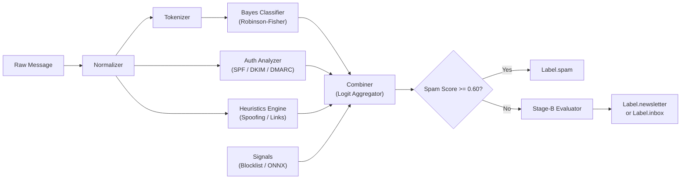
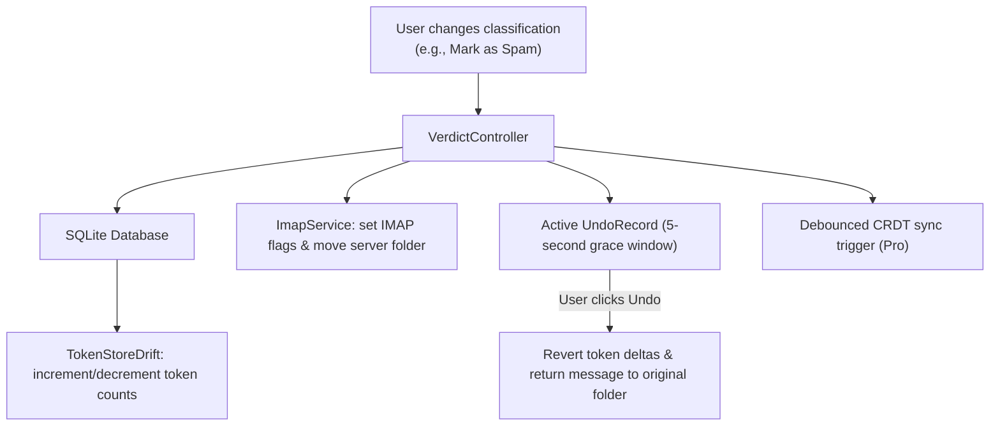

# Spam Filter Pipeline

DataFortress Mail incorporates a multi-stage classification pipeline that runs entirely on-device. The engine evaluates incoming emails across probabilistic token analysis, sender authentication checks, static security heuristics, and local community blocklist matches.

## Filter Architecture

The classification process executes sequentially through six distinct processing units:

### 1. Normalizer (`packages/spam_core/lib/src/normalizer.dart`)
Transforms heterogeneous RFC-822 messages into a deterministic representation:
- Strips personal identifying information (PII) such as recipient email addresses.
- Decodes quoted-printable and base64 body encodings.
- Extracts plain text from HTML, stripping comments, script tags, and metadata.
- Extracts raw hyperlink URLs and parses the sender domain (distinguishing freemail providers from private domains).

### 2. Tokenizer (`packages/spam_core/lib/src/tokenizer.dart`)
Generates 64-bit hashed tokens from normalized message text:
- Tokenizes words with length between 2 and 32 characters.
- Extracts specialized feature tokens: `header:*`, `domain:*`, `tld:*`, `url_host:*`.
- Hashes tokens using 64-bit FNV-1a to minimize memory footprint and prevent token dictionary leakage.

### 3. Robinson-Fisher Bayes (`packages/spam_core/lib/src/bayes.dart`)
Calculates an initial spam probability using the Robinson-Fisher chi-squared combination:
- Evaluates individual token probabilities $P(W) = \frac{s}{s + h}$, smoothed with a background prior ($s=1, h=1$).
- Selects the most significant tokens deviating from a neutral 0.5 probability.
- Combines token probabilities into chi-squared statistics $H = -2 \sum \ln(p)$ and $S = -2 \sum \ln(1 - p)$, producing a normalized Bayes score in `[0.0, 1.0]`.

### 4. Authentication Results (`packages/spam_core/lib/src/auth_results.dart`)
Parses `Authentication-Results` and `Received-SPF` headers inserted by trusted inbound mail servers:
- **DMARC**: `pass` provides strong positive weight (-0.15 weight, -1.0 logit); `fail` incurs a heavy spam penalty (+0.35 weight, +1.8 logit).
- **SPF**: `fail` and `softfail` add penalties (+0.20 and +0.10 weight, +1.0 logit).
- **DKIM**: `fail` adds an authentication penalty (+0.20 weight, +1.0 logit).

### 5. Heuristics Engine (`packages/spam_core/lib/src/heuristics.dart`)
Performs deterministic structural and lexical threat checks:
- **Display-Name Spoofing**: Detects display names formatted as email addresses differing from the envelope sender, or pretending to be recognized financial/tech institutions (+2.0 logit).
- **Link Mismatches**: Flags HTML anchor tags where the visible link text displays a domain different from the actual `href` destination (+2.5 logit).
- **Disposable Email Domains**: Identifies temporary mailboxes from known disposable service lists (+1.5 logit).

### 6. Signal Combiner (`packages/spam_core/lib/src/combiner.dart`)
Aggregates Bayes probability and heuristic evidence into an overall spam score via log-odds:
$$\text{logit} = \ln\left(\frac{P_\text{bayes}}{1 - P_\text{bayes}}\right) + \sum \Delta\text{logit}_i$$
$$P_\text{combined} = \frac{1}{1 + e^{-\text{logit}}}$$

---

## Classification Labels & Thresholds

The classifier assigns one of three primary labels:

| Label | Criteria | Action |
|---|---|---|
| `Label.spam` | Combined spam score $\ge 0.60$ | Scores $\ge 0.90$ are moved to Junk and flagged on IMAP. Scores in $[0.60, 0.90)$ are placed in the unsure review band. |
| `Label.newsletter` | Spam score $< 0.60$ and Stage-B score $\ge 0.45$ | Routed to the Newsletters folder/view. |
| `Label.inbox` | Spam score $< 0.60$ and Stage-B score $< 0.45$ | Personal and transactional messages routed to primary Inbox. |

### Stage-B: Newsletter Detection
When a message passes the spam check ($P_\text{spam} < 0.60$), the Stage-B classifier tests for automated bulk newsletters using header indicators and token ratios:
- `List-Unsubscribe` header (+0.45 score)
- `List-Id` header (+0.35 score)
- `Precedence: bulk` or `Precedence: list` (+0.30 score)
- Token ratio between trained newsletter and inbox token counts ($\pm 0.25$ max score bias)

---

## Cold Start & Seed Prior

On a brand-new installation with an empty database, Bayes classification cannot compute probabilities without prior token frequencies. DataFortress Mail addresses this cold-start state via two mechanisms:

1. **Seed Prior (`app/assets/prior_model.json`)**:
   !!! note "Seed Prior Honest Assessment"
       The bundled `prior_model.json` is a **hand-curated seed** containing approximately 25 high-confidence spam tokens (e.g., `viagra`, `cialis`, `casino`, `pharmacy`, `rolex`, `mortgage`). It is **not** a trained statistical model derived from large public email corpora. Its sole purpose is to provide immediate detection for blatant unsolicited bulk mail before the user trains the filter.
2. **Local Cold-Start Training (`app/lib/filter/cold_start.dart`)**:
   During initial account synchronization, `ColdStartTrainer` scans the user's existing mailbox folders:
   - Scans the IMAP Junk/Spam folder and trains all existing messages as `Label.spam`.
   - Scans the Sent folder to extract legitimate recipient email addresses and registers them in the local `contacts` table with `trust_level = 1` and `always_allow_images = 1`.

---

## Learning from Verdicts & Undo

The filter continuously adapts to user preferences through explicit interaction:

- **Incremental Training (`app/lib/filter/verdict_controller.dart`)**:
  When a user reclassifies a message (e.g., marks an inbox email as spam), `VerdictController` updates token frequencies in the local SQLite `tokens` table via `TokenStoreDrift.apply()`. If the user moves a message out of Junk back to Inbox, the previous spam counts are decremented and ham counts incremented.
- **IMAP Synchronization**:
  Flag updates (`$Spam`, `$NotSpam`) and IMAP `MOVE` commands execute against the mail server. If the device is offline, operations are queued in `pending_imap_actions` for replay.
- **5-Second Undo Grace Window**:
  An active `UndoRecord` holds an undo timer. If the user accidentally reclassifies a message, clicking **Undo** immediately reverts token adjustments and restores the message to its prior folder.

---

## The Evidence Sheet

To eliminate black-box classification decisions, DataFortress Mail provides an on-device inspection sheet for every scored message:

- **Access**: Available from the reader view by tapping the classification badge.
- **Contents (`app/lib/ui/filter/evidence_sheet.dart`)**:
  - Total calculated spam probability percentage.
  - List of contributing signals, showing signal identifier (e.g., `bayes`, `auth_dmarc_fail`, `link_mismatch`, `community_blocklist`), numerical weight adjustment, and human-readable explanation.
- No telemetry is transmitted when opening or viewing the Evidence Sheet.
