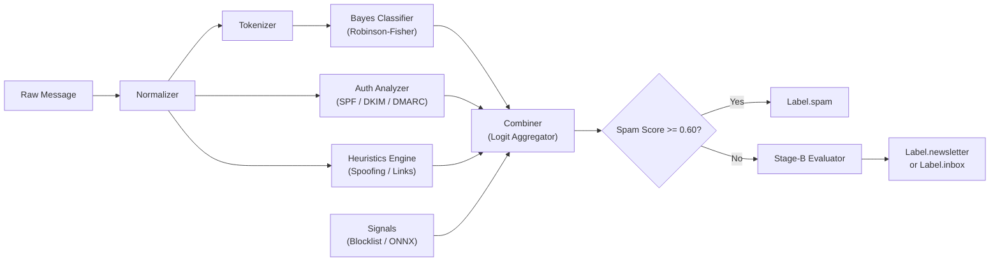
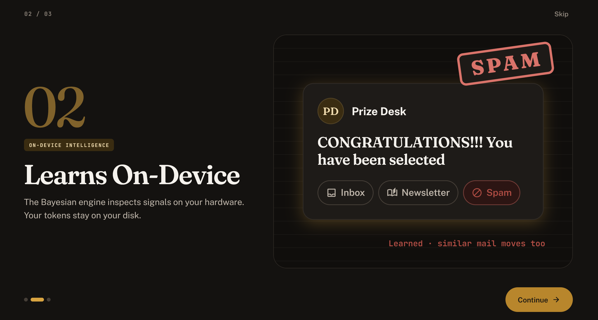
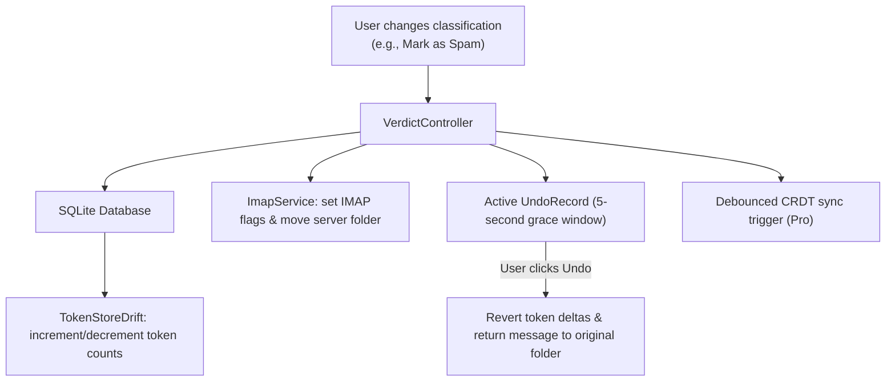
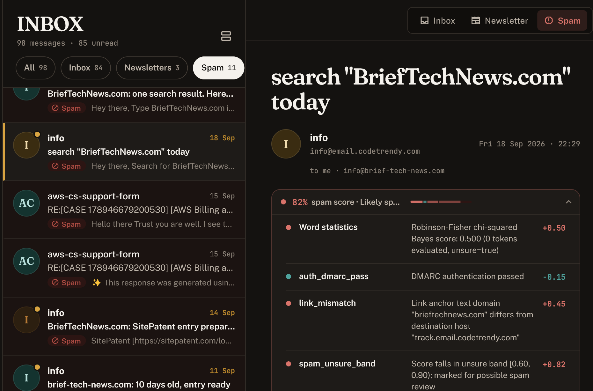
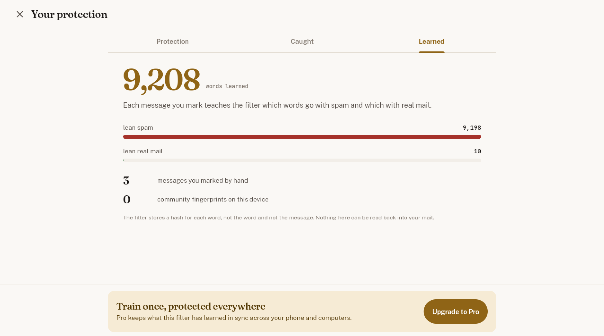
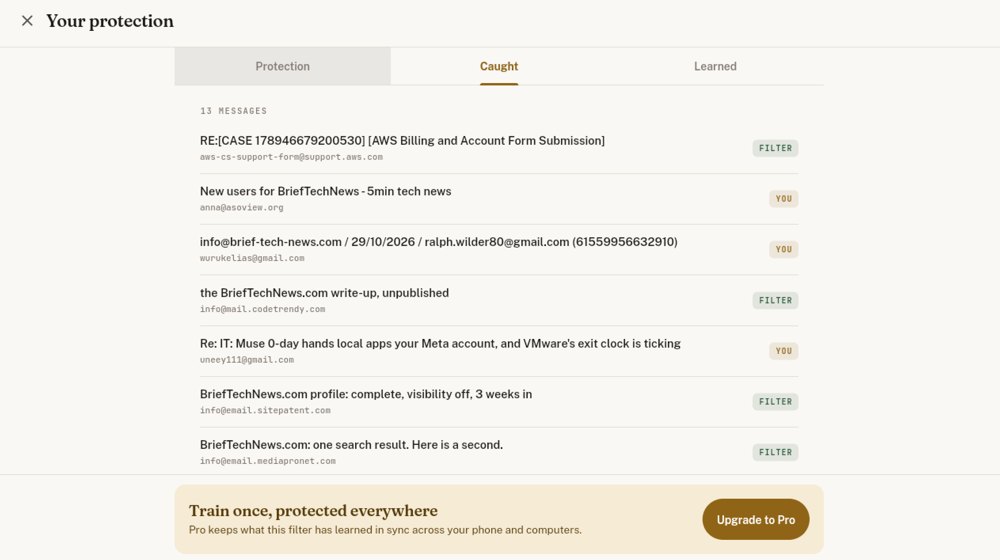

# Spam Filter Pipeline

DataFortress Mail incorporates a multi-stage classification pipeline that runs entirely on-device. The engine evaluates incoming emails across probabilistic token analysis, sender authentication checks, static security heuristics, and local community blocklist matches.

## Filter Architecture

The classification process executes sequentially through six distinct processing units:

### 1. Normalizer (`packages/spam_core/lib/src/normalizer.dart`)
Transforms heterogeneous RFC-822 messages into a deterministic representation:
- Strips personal identifying information (PII) such as recipient email addresses.
- Decodes quoted-printable and base64 body encodings.
- Extracts plain text from HTML, stripping comments, script tags, and metadata.
- Extracts raw hyperlink URLs and parses the sender domain (distinguishing freemail providers from private domains).

### 2. Tokenizer (`packages/spam_core/lib/src/tokenizer.dart`)
Generates 64-bit hashed tokens from normalized message text:
- Tokenizes words with length between 2 and 32 characters.
- Extracts specialized feature tokens: `header:*`, `domain:*`, `tld:*`, `url_host:*`.
- Hashes tokens using 64-bit FNV-1a to minimize memory footprint and prevent token dictionary leakage.

### 3. Robinson-Fisher Bayes (`packages/spam_core/lib/src/bayes.dart`)
Calculates an initial spam probability using the Robinson-Fisher chi-squared combination:
- Evaluates individual token probabilities $P(W) = \frac{s}{s + h}$, smoothed with a background prior ($s=1, h=1$).
- Selects the most significant tokens deviating from a neutral 0.5 probability.
- Combines token probabilities into chi-squared statistics $H = -2 \sum \ln(p)$ and $S = -2 \sum \ln(1 - p)$, producing a normalized Bayes score in `[0.0, 1.0]`.

### 4. Authentication Results (`packages/spam_core/lib/src/auth_results.dart`)
Parses `Authentication-Results` and `Received-SPF` headers inserted by trusted inbound mail servers:
- **DMARC**: `pass` provides strong positive weight (-0.15 weight, -1.0 logit); `fail` incurs a heavy spam penalty (+0.35 weight, +1.8 logit).
- **SPF**: `fail` and `softfail` add penalties (+0.20 and +0.10 weight, +1.0 logit).
- **DKIM**: `fail` adds an authentication penalty (+0.20 weight, +1.0 logit).

### 5. Heuristics Engine (`packages/spam_core/lib/src/heuristics.dart`)
Performs deterministic structural and lexical threat checks:
- **Display-Name Spoofing**: Detects display names formatted as email addresses differing from the envelope sender, or pretending to be recognized financial/tech institutions (+2.0 logit).
- **Link Mismatches**: Flags HTML anchor tags where the visible link text displays a domain different from the actual `href` destination (+2.5 logit).
- **Disposable Email Domains**: Identifies temporary mailboxes from known disposable service lists (+1.5 logit).

### 6. Signal Combiner (`packages/spam_core/lib/src/combiner.dart`)
Aggregates Bayes probability and heuristic evidence into an overall spam score via log-odds:
$$\text{logit} = \ln\left(\frac{P_\text{bayes}}{1 - P_\text{bayes}}\right) + \sum \Delta\text{logit}_i$$
$$P_\text{combined} = \frac{1}{1 + e^{-\text{logit}}}$$

---

## Classification Labels & Thresholds

The classifier assigns one of three primary labels:

| Label | Criteria | Action |
|---|---|---|
| `Label.spam` | Combined spam score $\ge 0.60$ | Scores $\ge 0.90$ are moved to Junk and flagged on IMAP. Scores in $[0.60, 0.90)$ are placed in the unsure review band. |
| `Label.newsletter` | Spam score $< 0.60$ and Stage-B score $\ge 0.45$ | Routed to the Newsletters folder/view. |
| `Label.inbox` | Spam score $< 0.60$ and Stage-B score $< 0.45$ | Personal and transactional messages routed to primary Inbox. |

### Stage-B: Newsletter Detection
When a message passes the spam check ($P_\text{spam} < 0.60$), the Stage-B classifier tests for automated bulk newsletters using header indicators and token ratios:
- `List-Unsubscribe` header (+0.45 score)
- `List-Id` header (+0.35 score)
- `Precedence: bulk` or `Precedence: list` (+0.30 score)
- Token ratio between trained newsletter and inbox token counts ($\pm 0.25$ max score bias)

---

## Cold Start & Seed Prior

On a brand-new installation with an empty database, Bayes classification cannot compute probabilities without prior token frequencies. DataFortress Mail addresses this cold-start state via two mechanisms:

1. **Trained prior (`app/assets/prior_model.json`)**:
   Trained with `tools/train_prior` on the SpamAssassin public corpus (1,896 spam, 4,150 ham), keeping the 20,000 most informative tokens and scaling the counts to 200 messages per class, so a user's own verdicts outweigh it quickly. The file holds only token hashes and counts, no message text. It is loaded once, into an empty token table; existing installs keep what they have learned. See [Measured Accuracy](#measured-accuracy-ci-benchmark) for what it does on its own.
2. **Local Cold-Start Training (`app/lib/filter/cold_start.dart`)**:
   During initial account synchronization, `ColdStartTrainer` scans the user's existing mailbox folders:
   - Scans the IMAP Junk/Spam folder and trains all existing messages as `Label.spam`.
   - Trains read Inbox and user-folder mail (spam score below 0.60, never Sent) as `Label.ham`, about as many messages as Junk had (at least 50, at most 500). Without this, every common word seen in Junk would score as spam. Runs once (setting `cold_start_ham_trained`), including on installs that already trained Junk only.
   - Scans the Sent folder to extract legitimate recipient email addresses and registers them in the local `contacts` table with `trust_level = 1` and `always_allow_images = 1`.

---

## Learning from Verdicts & Undo

The filter continuously adapts to user preferences through explicit interaction:

- **Incremental Training (`app/lib/filter/verdict_controller.dart`)**:
  When a user reclassifies a message (e.g., marks an inbox email as spam), `VerdictController` updates token frequencies in the local SQLite `tokens` table via `TokenStoreDrift.apply()`. If the user moves a message out of Junk back to Inbox, the previous spam counts are decremented and ham counts incremented.
- **IMAP Synchronization**:
  Flag updates (`$Spam`, `$NotSpam`) and IMAP `MOVE` commands execute against the mail server. If the device is offline, operations are queued in `pending_imap_actions` for replay.
- **8-Second Undo Grace Window**:
  An active `UndoRecord` holds an undo timer (8 seconds). If the user accidentally reclassifies a message, clicking **Undo** immediately reverts token adjustments and restores the message to its prior folder.
- **Identical copies follow the verdict**:
  When the same mail is delivered several times, marking one copy as spam also moves the other copies to Junk. A copy qualifies when it is in the same account, has the same sender address and subject (case-insensitive), and has the same body: identical normalized text, or at least 6 of the 8 MinHash body bands equal. Mail already in Junk, Trash, Sent or Drafts, mail already labelled spam, and mail you judged by hand (`classifications.user_overridden = 1`) are never touched. **Undo** restores every copy. The copies are trained on like any spam verdict, but only one community report and one auto-unsubscribe is made for the group. Their IMAP moves run one after another on a single queue. Copies that arrive later are not covered by this; the filter catches them through the token counts and the community blocklist.
- **Auto-Unsubscribe on Spam (`app/lib/mail/unsubscribe_service.dart`)**:
  When a user marks an email as spam, `VerdictController` schedules an automatic unsubscribe after a 10-second delay (buffering the 8-second undo window):
  - **Cancel on Undo**: Clicking **Undo** or assigning any non-spam verdict cancels the pending unsubscribe timer. An undo of a ham verdict that reverts to spam does not schedule an unsubscribe.
  - **Spam Verdict Only**: Unsubscribe is never automated during background sync classification; it requires an explicit user spam verdict to prevent silent cancellation of wanted mail on false positives or verifying email liveness to spammers.
  - **Authentication Guard**: Automated verdict unsubscribe requires verified sender authentication (`dmarc=pass` or `dkim=pass` extracted from `Authentication-Results` at sync and stored in `messages.sender_auth_pass`). Unauthenticated senders are skipped.
  - **Execution Priority**: Uses RFC 8058 One-Click HTTPS POST (`List-Unsubscribe-Post: List-Unsubscribe=One-Click`) if available; otherwise falls back to RFC 2369 mailto. Plain HTTP links without one-click are never followed.
  - **Comprehensive Safety Guards**: SSRF protection (HTTPS port 443 only, pre-resolved public IPs, no internal/private/CGNAT/ULA IPs, no redirects followed), request hygiene (no cookies/credentials, generic user-agent), mailto safety (single recipient, no CRLF/header injection), 30-day idempotency deduplication per sender domain, 24-hour failure backoff (max 3 retries), self-domain check, and a 20 attempt/24h rate cap.
  - **User Controls**: Toggleable via the `auto_unsubscribe` switch in Settings (default ON). When disabled, marking spam does not schedule an unsubscribe. For newsletters and auto-classified messages, the message reader provides an on-demand **Unsubscribe** button (bypassing only the sender authentication guard).

---

## The Evidence Sheet

To eliminate black-box classification decisions, DataFortress Mail provides an on-device inspection sheet for every scored message:

- **Access**: Available from the reader view by tapping the classification badge.
- **Contents (`app/lib/ui/filter/evidence_sheet.dart`)**:
  - Total calculated spam probability percentage.
  - List of contributing signals, showing signal identifier (e.g., `bayes`, `auth_dmarc_fail`, `link_mismatch`, `community_blocklist`), numerical weight adjustment, and human-readable explanation.
- No telemetry is transmitted when opening or viewing the Evidence Sheet.

## The Protection Screen

Tapping a figure in the sidebar's "Your filter" card (`app/lib/ui/protection/`) opens a full-screen view that replays your own spam in four stages. Counts come from the local `classifications` table (`app/lib/filter/protection_stats.dart`); nothing is estimated and nothing is sent anywhere.

| Stage | What it shows |
|---|---|
| No filter | Every message stored as spam would have reached the inbox. |
| Our app | Spam the on-device filter catches by itself. Messages you marked by hand count here, since your verdict trains the filter. |
| App + community | Spam that only crossed the 0.60 threshold because the community blocklist signal was on. For each stored message with `community` evidence, the score is recomputed without the signal (`Classifier.scoreWithoutCommunity`). |
| Pro | Not a measurement. It shows what a new device knows with and without encrypted filter sync (the learned-word count carried over versus zero), with the upgrade card. It does not claim a higher catch rate: the neural scorer is not shipped yet (see [Premium](premium.md)). |

Other tabs list caught messages (labelled Filter, Community or You) and what was learned. "Words learned" counts rows in `tokens`; the filter stores hashes, so no word list can be shown. When nothing has been caught yet the screen shows example numbers, clearly labelled as a sample. The "Pro" upgrade card appears for non-Pro users and opens the same upsell sheet as Settings, with price and renewal terms.

---

## Measured Accuracy & CI Benchmark

To prevent regressions in spam detection and ensure legitimate personal and transactional emails are never silently discarded, the filter is validated on every continuous integration run via an automated benchmark suite (`packages/spam_core/test/eval_test.dart`):

- **Synthetic Evaluation Suite**:
  A curated corpus of ~70 synthetic RFC 822 / EML test fixtures (`packages/spam_core/test/fixtures/eval/`):
  - **Spam (~30 files)**: Across diverse threat categories including lottery, pharmaceuticals, fake invoices, crypto scams, inheritance fraud, replica luxury goods, predatory lending, and unsolicited bulk commercial mail.
  - **Ham (~30 files)**: Realistic personal correspondence, business syncs, transactional order receipts, utility statements, appointment reminders, newsletters with RFC 8058/2369 `List-Unsubscribe` headers, and multilingual emails (including German).
  - **Phishing (~10 files)**: Targeting top brands and financial institutions using credential-harvesting techniques.
- **Accuracy Gates**:
  1. **Zero Ham Auto-Moves**: The false-positive auto-move rate must strictly equal $0.0\%$ (no legitimate email scored $\ge 0.90$).
  2. **Minimal False Positives**: The false-positive flag rate must not exceed $5.0\%$ (share of legitimate ham scored $\ge 0.60$).
  3. **High Spam Recall**: At least $80.0\%$ of unseen spam messages must be identified (scored $\ge 0.60$).
  4. **100% Phishing Detection**: Every phishing fixture must trigger `Verdict.isPhishing`.

- **Prior on real mail** (SpamAssassin public corpus, model trained on 80 %, scored on the held-out 20 %, prior only: no user training, contacts or rules):

  | Measure | Result |
  |---|---|
  | Spam caught (score ≥ 0.60) | 97.4 % (370 / 380) |
  | Spam moved to Junk (≥ 0.90) | 93.4 % |
  | Ordinary ham moved to Junk (≥ 0.90) | 1.0 % (8 / 784) |
  | "Hard ham" (commercial HTML newsletters) moved to Junk | 37 % (17 / 46) |

  The corpus is from 2002–2005 and has no `Authentication-Results` headers, so the DMARC/DKIM signals never fire here. On a device, cold-start ham training, the known-contact cap and sender rules all lower false positives further. Reproduce with `train_prior eval` (see [Train Prior](../reference/train-prior.md)).

---

## Phishing & Evasion Detection

Phishing attacks differ fundamentally from conventional bulk marketing spam: they often contain minimal text, impersonate trusted brands, or hijack legitimate infrastructure. DataFortress Mail implements dedicated phishing heuristics (`packages/spam_core/lib/src/phishing.dart`):

### 1. Phishing Evidence Signals
The classifier flags messages with `Verdict.isPhishing == true` when any of the seven core phishing signals are detected:
- **`display_name_spoof_email` (+2.0 logit)**: The From display name contains an embedded email address conflicting with the actual sender domain (e.g., `From: "service@paypal.com" <scammer@evil.com>`).
- **`display_name_brand_spoof` (+2.0 logit)**: The From display name claims a known brand (e.g., `"PayPal Security"`, `"Apple Support"`, `"Microsoft 365"`) but the message originates from an unassociated domain.
- **`lookalike_domain` (+3.0 logit)**: The sender domain or hyperlink destination is a homoglyph or typo-squatted brand lookalike within Damerau-Levenshtein edit distance 1–2 (e.g., `paypa1.com`, `app1e.com`, `micros0ft.com`).
- **`punycode_domain` (+2.0 logit)**: The sender domain or embedded link host utilizes internationalized punycode (`xn--...`), frequently used for IDN homograph attacks.
- **`link_mismatch` (+2.5 logit)**: An HTML anchor tag displays a visible URL pointing to a reputable service while the hidden `href` redirects to an external malicious domain.
- **`reply_to_mismatch` (+1.5 logit)**: The `Reply-To` address routes to a free webmail provider (e.g. Gmail, Yahoo) while the `From` header claims corporate or financial institution identity.
- **`dangerous_attachment` (+3.0 logit)**: Attachments with executable, script, or container extensions (`.exe`, `.scr`, `.bat`, `.vbs`, `.iso`, `.hta`), or deceptive double extensions (`invoice.pdf.exe`).

### 2. Contact Cap Override
While legitimate mail from known contacts is normally protected by a `-2.5` logit reduction and capped at a maximum spam score of $0.89$ to prevent automatic junk moves, **the presence of any phishing signal overrides this cap**. This protects users against compromised contact accounts or forged sender headers.

---

## Sender Rules & Screener

Users maintain explicit deterministic control over senders and sender domains via Sender Rules and the Mailbox Screener:

### 1. Sender Rules (`app/lib/filter/sender_rules.dart`)
- **Address vs Domain Rules**: Users can configure `allow` or `block` rules targeting specific email addresses or entire domains. Address rules take precedence over domain rules. Domain rules match the domain and all subdomains (e.g. `example.com` matches `mail.example.com`).
- **Freemail Protection**: To prevent accidentally blocking millions of legitimate users, domain-level rules are restricted to private domains; public freemail domains (such as `@gmail.com`, `@yahoo.com`, `@outlook.com`) can only be blocked or allowed by specific individual email address.
- **Classifier Integration**:
  - `block` rule: Instantly forces spam score to $1.0$ with evidence `sender_blocked`.
  - `allow` rule: Clamps spam score to at most $0.05$ with evidence `sender_allowed` (while preserving any phishing warning banners).

### 2. Mailbox Screener (`app/lib/filter/screener.dart`)
The Screener isolates correspondence from unfamiliar senders:
- **New Senders**: Messages arriving in the Inbox whose sender is not a saved contact, has no explicit allow rule, and has no prior correspondence in the account outside Junk and Trash.
- **Screener Modes**:
  - `tab` (default): New-sender mail remains in the primary Inbox while also appearing under the "New Senders" mailbox chip for quick batch triage.
  - `strict`: Mail from unknown senders is excluded from the primary Inbox query and only visible under the "New Senders" view until allowed or replied to.
