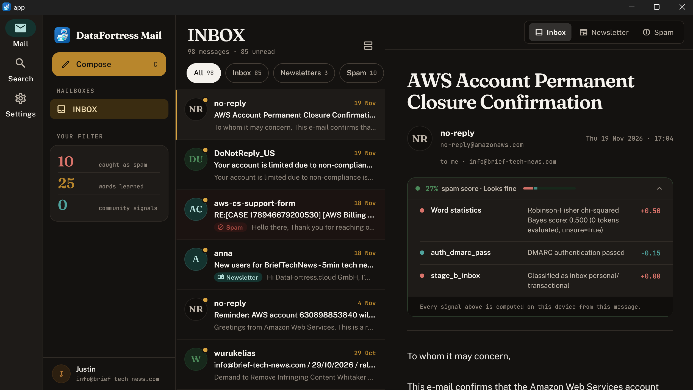

# Design System: The Ledger Desk

DataFortress Mail adheres to a bespoke design system codenamed **"The Ledger Desk"**. Engineered for calm, high-density editorial productivity, it borrows visual metaphors from physical bookbinding, accounting ledgers, and ink-on-paper editorial prints.

The design system is implemented through `df_theme` (from `df_flutter_shared`) and configured locally in `app/lib/theme/`.

---

## Brand Philosophy and Visual Metaphor

The interface avoids neon accents, excessive rounded bubbles, and arbitrary decorative gradients. Instead, it prioritizes:

- **Ink-on-Paper Restraint**: High-contrast, tactile reading surfaces with paper-tinted backgrounds and crisp black/charcoal type.
- **Physical Ledger Signals**: Muted, purposeful status colors (brass, verdigris, oxblood) reflecting audit records and financial ledgers.
- **Editorial Typography**: Pairing a high-contrast serif for headings with a legible sans-serif for UI controls and tabular monospace for figures.
- **Tactile Stamps & Evidence**: State changes are communicated via deliberate stamps (e.g., rubber-stamp animations) and clear tabular breakdowns ("Signal Ledger").

---

## Palette and Color Roles

The theme definition resides in `app/lib/theme/app_brand.dart` using `DfBrandPresets.dataFortress()`. Colors are exposed through `context.df.colors`.

### Semantic Color Assignments

| Role | Meaning | Palette Token |
| --- | --- | --- |
| **Brand Accent** | Primary actions, branding, key highlights | Brass (`palette.accent.base` / `#A8781F`) |
| **Inbox / Ham** | Clean mail, verified personal correspondence | Neutral ink (`palette.textPrimary`) |
| **Newsletter** | Safe commercial mail, subscriptions, digests | Verdigris (`palette.accent.base` / `#2F6F6B`) |
| **Spam Alert** | Phishing, unsolicited marketing, unauthenticated mail | Oxblood (`palette.error.base`) |
| **Unsure / Review** | Marginal confidence scores requiring user confirmation | Warning amber (`palette.warning.base`) |
| **Learned** | Tokens trained into local Bayesian database | Success green (`palette.success.base`) |

### Consuming Colors via `AppTheme`

Widgets must never hardcode color values. To map classification verdicts to UI colors, always use the helper in `app/lib/theme/app_theme.dart`:

```dart
import 'package:app/theme/app_theme.dart';
import 'package:spam_core/spam_core.dart';

// Resolves oxblood for spam, verdigris for newsletter, textPrimary for ham/inbox
final color = AppTheme.classificationColor(context, Label.spam);
final icon = AppTheme.classificationIcon(Label.spam);
```

For general surfaces and typography, read directly from the theme extension:

```dart
final c = context.df.colors;
final backgroundColor = c.surfacePrimary;
final textColor = c.textPrimary;
```

---

## Typography: `AppType`

All typography is centralized in `app/lib/theme/app_type.dart`. The application bundles three open-source fonts locally under `app/assets/fonts/`:

1. **Fraunces** (`Fraunces.ttf`): Variable display serif font used for mastheads, major screen titles, and section headlines.
2. **Public Sans** (`Public Sans.ttf`): Neutral, highly legible sans-serif used for UI controls, body text, and reading panes.
3. **JetBrains Mono** (`JetBrainsMono.ttf`): Monospace font used for email headers, metadata, spam scores, and token inspection.

No runtime network requests to Google Fonts or third-party CDNs are permitted.

### Typographic Helpers

```dart
import 'package:app/theme/app_type.dart';

// Display font (Fraunces variable font with optical size and soft curves)
Text(
  'DataFortress',
  style: AppType.display(c.textPrimary, size: 28, weight: 600),
);

// UI font (Public Sans for body and labels)
Text(
  UiStrings.sidebarMailboxes,
  style: AppType.ui(c.textSecondary, size: 14, weight: FontWeight.w500),
);

// Monospace font (JetBrains Mono with tabular figures enabled)
Text(
  '0.9842',
  style: AppType.mono(c.error.deep, size: 11.5, weight: FontWeight.w700),
);
```

The monospace helper automatically activates `FontFeature.tabularFigures()` so numerical tables, evidence percentages, and hash values align vertically.

---

## Layout, Density, and Breakpoints

The client supports responsive multi-pane layouts across mobile and desktop displays.

### Responsive Breakpoints

Defined in `AppTheme`:

- **Single Pane** (`< 700dp`): Mobile and narrow desktop windows. Stack navigation between mailbox, conversation view, and composer.
- **Two Pane** (`700dp – 1100dp`): Tablet and standard desktop. Left sidebar/list with right reading pane.
- **Three Pane** (`≥ 1100dp`): Widescreen desktop. Left folder drawer, middle email list, right active reader.

```dart
if (AppTheme.isThreePane(MediaQuery.of(context).size.width)) {
  // Render folder drawer + message list + message reader
}
```



### Row Density

User-configurable density toggles in mailbox list views (`AppTheme`):

- **Comfortable**: `72.0dp` row height with sender avatar (`DfAvatar`), subject preview, date, and verdict pill.
- **Compact**: `52.0dp` row height with single-line summary for high-throughput triage.

---

## Core Styling Rules

When submitting contributions, ensure your code respects these design system constraints:

1. **Zero Hardcoded Colors**: Never write `Colors.white`, `Colors.black`, or `Color(0xFF...)` in view components. Use `context.df.colors` tokens.
2. **Centralized UI Copy**: Never hardcode display text in widget trees. All strings must be declared in `AppStrings` (`app/lib/app/strings.dart`) or `UiStrings` (`app/lib/app/ui_strings.dart`). See [Contributing Guide](index.md).
3. **Tabular Monospace for Metrics**: All numerical statistics, Bayesian scores, token weights, and email headers must use `AppType.mono(...)`.
4. **Restrained Motion**: Animations are limited to functional feedback (e.g., the 8-second undo countdown and the tactile rubber-stamp verdict indicator). Avoid extraneous bounce or parallax effects.
