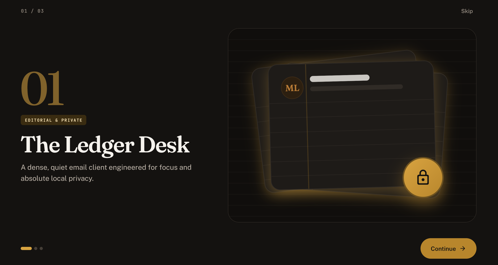
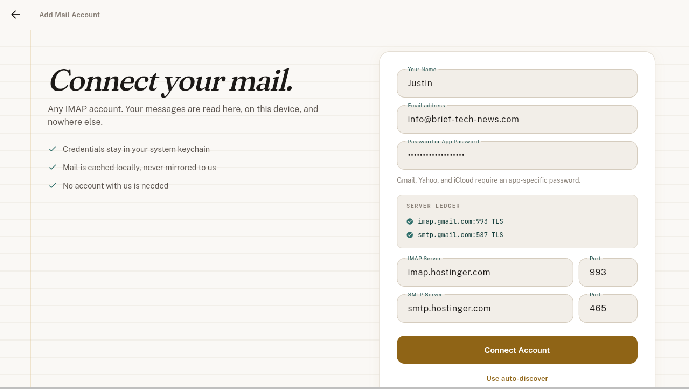

# Configuration & Environment Flags

DataFortress Mail is designed to function as an autonomous, self-contained email client without requiring any backend services, registration keys, or API tokens.

This page documents the compile-time `--dart-define` parameters recognized by the client and explains exactly what functions offline versus what relies on hosted infrastructure.

---

## Environment Variables (`String.fromEnvironment`)

The client codebase defines these compile-time environment flags using `String.fromEnvironment`:

| Variable | File | Default Value | Purpose |
|---|---|---|---|
| `BACKEND_URL` | `app/lib/api/backend_config.dart` (used by `api_client.dart` and `report_client.dart`) | `https://emailprogram-spamfilter-backend-api.datafortress.cloud` (the hosted backend) | Base URL for community blocklist sync, threat reports, and ham dispute votes. |
| `REVENUECAT_API_KEY` | `app/lib/platform/native_services.dart` | `""` (empty string) | Public SDK key for RevenueCat subscription and entitlement management. |
| `GOOGLE_OAUTH_CLIENT_ID_IOS` | `app/lib/mail/oauth/oauth_config.dart` | `""` | Google OAuth client ID used on iOS **and macOS**. |
| `GOOGLE_OAUTH_CLIENT_ID_ANDROID` | `app/lib/mail/oauth/oauth_config.dart` | `""` | Google OAuth client ID used on Android. |
| `GOOGLE_OAUTH_CLIENT_ID_DESKTOP` | `app/lib/mail/oauth/oauth_config.dart` | `""` | Google OAuth client ID used on Windows and Linux. |
| `GOOGLE_OAUTH_CLIENT_SECRET_DESKTOP` | `app/lib/mail/oauth/oauth_config.dart` | `""` | The (non-confidential) secret Google issues with a Desktop-type client; sent only on Windows and Linux. |
| `MS_OAUTH_CLIENT_ID` | `app/lib/mail/oauth/oauth_config.dart` | `""` | Microsoft (Entra) application client ID, used on every platform. |

### 1. `BACKEND_URL`
- **Location**: `app/lib/api/backend_config.dart`, defined once and read by both the authenticated client and the anonymous community client.
- **When unset**: Defaults to the hosted backend, `https://emailprogram-spamfilter-backend-api.datafortress.cloud`. Community blocklist sync and anonymous spam reporting are therefore live in a default build (reporting can be switched off under Settings → Privacy).
- **Behavior**:
  - The application periodically requests blocklist snapshots from `/v1/blocklist/snapshot` and deltas from `/v1/blocklist/delta`.
  - When the user manually flags spam or rescues ham, anonymous fingerprint payloads are posted to `/v1/reports` and `/v1/votes/ham`.
  - If the backend is unreachable (offline, or a custom URL with no server), all network requests fail gracefully with logged exceptions (`[community report]`, `[community snapshot]`).
  - **No UI errors or crashes occur.** Local mail retrieval and on-device spam filtering proceed unhindered.
- **Customization**:
  ```bash
  flutter run -d linux --dart-define=BACKEND_URL=http://localhost:8000   # e.g. a backend you run locally
  ```

### 2. `REVENUECAT_API_KEY`
- **Location**: `app/lib/platform/native_services.dart:16`
- **When unset**: Defaults to `""` (empty string).
- **Behavior**:
  - When empty, `NativePlatformServices.initialize()` skips calling `DfRevenueCat.initialize()`.
  - The paywall presented in the onboarding funnel remains skippable via "Maybe later".
  - Pro features that require cloud subscription validation are disabled, and the app remains entirely in the free, local tier.
- **Customization**:
  ```bash
  flutter run -d macos --dart-define=REVENUECAT_API_KEY=appl_your_revenuecat_key
  ```

### 3. OAuth client IDs (Google and Microsoft sign-in)
- **Location**: `app/lib/mail/oauth/oauth_config.dart`. The PKCE exchange, token refresh and the interactive flows come from the shared `df_oauth` package; this file only supplies the mail scopes, client IDs and redirect URIs.
- **When unset**: The "Continue with Google" and "Continue with Microsoft" buttons in the account wizard stay visible. Tapping one for a provider whose client ID is empty shows "Google sign-in is not configured in this build" (or the Microsoft equivalent) instead of starting a flow. Password accounts are unaffected.
- **Scopes requested**:
  - Google: `https://mail.google.com/`, `openid`, `email`, `profile`.
  - Microsoft (authority `common`, so personal and work/school accounts): `https://outlook.office.com/IMAP.AccessAsUser.All`, `https://outlook.office.com/SMTP.Send`, `offline_access`, `openid`, `email`, `profile`.
- **Redirect URIs to register** (the application ID / bundle ID is `com.datafortress.spamfilteringemailclient`):

  | Platform | Google | Microsoft |
  |---|---|---|
  | Android | `com.datafortress.spamfilteringemailclient:/oauth2redirect` | `msauth://com.datafortress.spamfilteringemailclient/oauth2redirect` |
  | iOS and macOS | the reversed client ID, e.g. `com.googleusercontent.apps.<id>:/oauth2redirect` | `msauth.com.datafortress.spamfilteringemailclient://auth` |
  | Windows and Linux | `http://127.0.0.1` (loopback, random port chosen at sign-in) | `http://127.0.0.1` (loopback, random port chosen at sign-in) |

  On iOS and macOS the reversed-client-ID scheme must also be listed under `CFBundleURLSchemes` in `Info.plist`; see [Platform notes](../contributing/platform-notes.md#oauth-sign-in-and-notifications-per-platform).
- **Provider-side requirements** (outside this repo): Google classifies `https://mail.google.com/` as a restricted scope, so a public release needs Google's app verification; until then the consent screen is limited to test users and refresh tokens are short-lived. Many Microsoft work or school tenants disable IMAP or SMTP AUTH, in which case only personal outlook.com, hotmail and live accounts connect.
- **Customization**:
  ```bash
  flutter run -d linux \
    --dart-define=GOOGLE_OAUTH_CLIENT_ID_DESKTOP=<id>.apps.googleusercontent.com \
    --dart-define=GOOGLE_OAUTH_CLIENT_SECRET_DESKTOP=<desktop-client-secret> \
    --dart-define=MS_OAUTH_CLIENT_ID=<application-client-id>
  ```

---

## Operational Capabilities Matrix

The following table details what works out-of-the-box with zero keys and no backend versus features that depend on hosted services:

| Feature Area | Works Offline / No Backend | Requires Hosted Backend or API Keys |
|---|---|---|
| **Email Accounts (IMAP/SMTP)** | **Yes.** Full connection to any standard IMAP/SMTP provider (Gmail, Outlook, iCloud, Fastmail, self-hosted) with a password or app password. | None. |
| **Google / Microsoft sign-in (OAuth2)** | **Yes, once client IDs are compiled in.** Talks only to Google and Microsoft, never to the DataFortress backend. | The OAuth client IDs above (a build without them shows "not configured" on tap). |
| **New-mail notifications** | **Yes.** Local notifications raised on the device while the app is running. | None. |
| **Email Viewing & Sync** | **Yes.** Periodic folder sync, UID tracking, body fetching, attachments, HTML sanitization, and remote image blocking. | None. |
| **Email Composition** | **Yes.** Plain-text composing with Cc/Bcc, Reply / Reply All / Forward (quoted text, `In-Reply-To`/`References` threading headers), and SMTP transmission via `enough_mail`. Attachments in both directions: attach files while writing (up to 18 MB in total), and forwards carry the original's files. | None. |
| **Local Bayesian Spam Filter** | **Yes.** Full Robinson-Fisher chi-squared classification based on `packages/spam_core`. | None. |
| **Cold Start Prior** | **Yes.** Seeds initial weights using the local asset `app/assets/prior_model.json`. | None. |
| **Filter Retraining** | **Yes.** Changing verdicts in the Verdict Bar immediately updates local SQLite token counts. | None. |
| **Evidence Sheet** | **Yes.** Explains token probabilities and SPF/DKIM/DMARC authentication results locally. | None. |
| **Secure Storage** | **Yes.** Credentials encrypted in native platform hardware keystore (`flutter_secure_storage`). | None. |
| **Community Blocklist Sync** | **No.** Cannot download global fingerprint lists without a reachable community backend. | Requires `BACKEND_URL` serving `/v1/blocklist/*`. |
| **Anonymous Spam Reporting** | **No.** Local MinHash LSH and URL hashes are not broadcast without a reachable backend. | Requires `BACKEND_URL` serving `/v1/reports`. |
| **Ham Dispute Votes** | **No.** False positive rescues cannot be broadcast without a reachable backend. | Requires `BACKEND_URL` serving `/v1/votes/ham`. |
| **Pro Encrypted Filter Sync** | **No.** Synchronizing trained tokens across devices requires Firebase Auth JWT and backend sync endpoint. | Requires `BACKEND_URL` and Firebase Auth. |
| **Pro Subscriptions** | **No.** In-app purchases and receipt validation require RevenueCat. | Requires `REVENUECAT_API_KEY`. |

---

## Funnel & Authentication Configuration

As configured in `app/lib/funnel/funnel_config.dart`:
```dart
static DfFunnelConfig get config => const DfFunnelConfig(
  steps: [
    DfFunnelStep.onboarding,
    DfFunnelStep.paywall,
  ],
  loginMode: DfLoginMode.deferred,
  paywallSkippable: true,
);
```

- **Deferred Login**: Login is not required to use DataFortress Mail. Users proceed directly to "Add Account" to configure IMAP credentials.
- **Skippable Paywall**: The paywall step is completely dismissible without entering payment details or authentication credentials.




