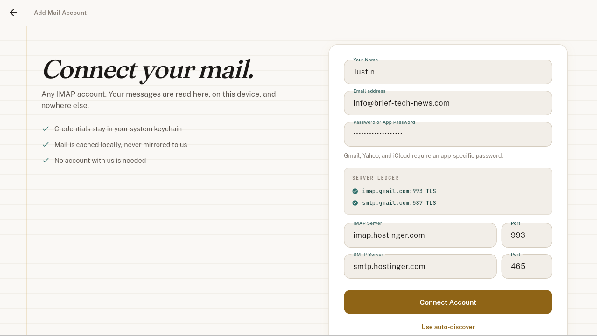

# Installation & Setup

This guide walks through cloning the repository, fulfilling OS-level build prerequisites, managing shared dependencies, and launching DataFortress Mail.

## Prerequisites

### Core Tooling
- **Flutter SDK**: a release that bundles Dart `^3.12.0` (developed against Flutter 3.50 stable)
- **Git**: Installed and accessible on your `PATH`

Verify your setup with:
```bash
flutter doctor -v
```

---

## Platform Dependencies

### Linux
The Flutter desktop engine on Linux requires standard GTK+ development libraries, CMake, and the Secret Service / keyring libraries used by `flutter_secure_storage`:

```bash
sudo apt update
sudo apt install -y \
  clang \
  cmake \
  ninja-build \
  pkg-config \
  libgtk-3-dev \
  libsecret-1-dev \
  gnome-keyring \
  libsecret-tools
```

!!! note "Wayland and Display Drivers"
    If encountering window initialization issues under Wayland compositors, force the X11 backend:
    ```bash
    GDK_BACKEND=x11 flutter run -d linux
    ```

### macOS
- **Xcode**: Version 15 or newer (installed via the Mac App Store or Apple Developer portal)
- **CocoaPods**: Required for native pod dependency resolution:
  ```bash
  sudo gem install cocoapods
  ```
- Ensure Xcode command-line tools are selected:
  ```bash
  sudo xcode-select --switch /Applications/Xcode.app/Contents/Developer
  sudo xcodebuild -runFirstLaunch
  ```

### Windows
- **Visual Studio 2022**: With the **"Desktop development with C++"** workload installed (including MSVC v143 toolset and Windows 10/11 SDK).

### Android
- **Android Studio**: Installed with Android SDK Platform 34+, Android SDK Build-Tools, and Android NDK.
- Set `ANDROID_HOME` to your Android SDK installation directory.

### iOS
- Requires macOS with Xcode 15+ and CocoaPods installed.
- Valid Apple Developer provisioning profile for on-device deployment (or iOS Simulator).

---

## Shared Library Dependency (`df_flutter_shared`)

The Flutter application relies on `df_flutter_shared` packages (`df_theme`, `df_ui_widgets`, `df_funnel`, `df_settings`, etc.) specified in `app/pubspec.yaml` as Git dependencies pointing to:

```yaml
df_theme:
  git:
    url: https://github.com/JustinGuese/df_flutter_shared.git
    path: df_theme
    ref: main
```

### Local Development with `pubspec_overrides.yaml`

When developing offline or testing changes across both repositories simultaneously, you can redirect Git dependencies to local directory checkouts using a `pubspec_overrides.yaml` file in `app/`.

1. Clone `df_flutter_shared` alongside this repository:
   ```
   workspace/
   ├── frontend/
   │   └── app/
   └── df_flutter_shared/
       ├── df_theme/
       ├── df_ui_widgets/
       └── ...
   ```

2. Create `app/pubspec_overrides.yaml` (this file is gitignored):
   ```yaml
   dependency_overrides:
     df_theme:
       path: ../../../df_flutter_shared/df_theme
     df_ui_widgets:
       path: ../../../df_flutter_shared/df_ui_widgets
     df_onboarding:
       path: ../../../df_flutter_shared/df_onboarding
     df_funnel:
       path: ../../../df_flutter_shared/df_funnel
     df_settings:
       path: ../../../df_flutter_shared/df_settings
     df_billing:
       path: ../../../df_flutter_shared/df_billing
     df_revenuecat:
       path: ../../../df_flutter_shared/df_revenuecat
     df_firebase_auth:
       path: ../../../df_flutter_shared/df_firebase_auth
     df_firebase_rest:
       path: ../../../df_flutter_shared/df_firebase_rest
     df_error_reporting:
       path: ../../../df_flutter_shared/df_error_reporting
     df_analytics:
       path: ../../../df_flutter_shared/df_analytics
     df_app_shell:
       path: ../../../df_flutter_shared/df_app_shell
     df_file_download:
       path: ../../../df_flutter_shared/df_file_download
     df_api:
       path: ../../../df_flutter_shared/df_api
   ```

---

## Fetching Dependencies & Running

1. Navigate to the `app` directory:
   ```bash
   cd app
   ```

2. Resolve Flutter packages:
   ```bash
   flutter pub get
   ```

3. Launch the application targeting your preferred platform:
   ```bash
   # Desktop targets
   flutter run -d linux
   flutter run -d macos
   flutter run -d windows

   # Mobile targets (with device connected or emulator running)
   flutter run -d android
   flutter run -d ios
   ```

Upon initial launch, DataFortress prompts you to add your IMAP/SMTP mail account:


