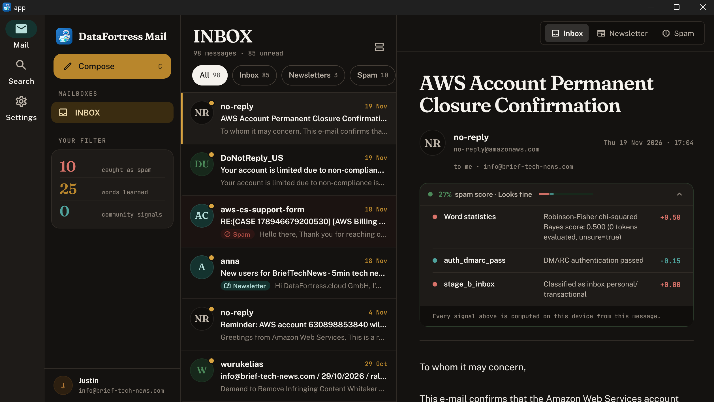

# DataFortress Mail Documentation

DataFortress Mail is a privacy-first, editorial desktop and mobile email client engineered for focus, local intelligence, and collective defense. It is built with Flutter, a pure Dart Bayesian classification core, and an optional zero-knowledge community backend protocol.



The project is structured as an open-core system:
- The full client application (`app/`), the Bayesian core engine (`packages/spam_core/`), offline model tooling (`tools/train_prior/`), and the client-server protocol are open source under the Apache-2.0 license.
- The hosted community reporting network and cloud synchronization services operate as hosted backend infrastructure with documented open client interfaces.

## Architectural Overview

The repository consists of three main codebases:

```
frontend/
├── app/                  # Multiplatform Flutter client (Linux, macOS, Windows, Android, iOS)
├── packages/
│   └── spam_core/        # Pure Dart engine (Bayesian classifier, MinHash LSH, URL hashing)
├── tools/
│   └── train_prior/      # CLI utility for ingesting EML corpora and generating prior models
└── docs/                 # Documentation sources (MkDocs Material)
```

### Core Components

- **Client Application (`app/`)**: Built on Flutter (Dart `^3.12`), utilizing Riverpod for state management, SQLite (via the `sqlite3` package) for on-device persistence, and `enough_mail` for standard IMAP/SMTP transport. Credentials are encrypted in platform hardware keystores via `flutter_secure_storage`.
- **Spam Core Engine (`packages/spam_core/`)**: Standalone, pure Dart package without Flutter UI dependencies. Implements a Robinson-Fisher chi-squared Bayesian classifier supporting three-way categorization (Inbox, Newsletter, Spam). Includes text normalization, tokenization with orthogonal sparse bigrams (OSB), 32-permutation MinHash locality-sensitive hashing (LSH), and URL sanitization/hashing.
- **Offline Training Tooling (`tools/train_prior/`)**: Offline CLI tool to ingest raw EML email files, compute word and token probabilities across labels, and emit clean JSON prior models.
- **Community Threat Protocol**: Anonymous, zero-ID community defense. Clients compute fuzzy cryptographic fingerprints locally and exchange blocklist updates with the backend without transmitting email bodies, subject lines, sender identities, or device identifiers.
- **Safe Auto-Unsubscribe**: Automatic unsubscription when marking emails as spam (and on-demand in the reader) via RFC 8058 One-Click (HTTPS POST) and RFC 2369 mailto. Operates directly between the user's device and the sender's published endpoint—never routed through the DataFortress backend—with comprehensive safety guards (10-second undo window, SSRF and private IP blocking, clean request hygiene, DMARC/DKIM sender authentication requirement, rate limiting, and an off switch in Settings).

!!! note "Model Caveat"
    The bundled default model (`app/assets/prior_model.json`) is a hand-curated seed model designed to establish baseline probabilities for cold-start filtering. It is not an exhaustively trained corpus. The filter learns dynamically on-device as users assign verdicts.

## Documentation Sections

### Getting Started
- [Installation](getting-started/install.md): Prerequisites for Linux, macOS, Windows, Android, and iOS; dependency setup with `pubspec_overrides.yaml`; building and running.
- [Configuration](getting-started/configuration.md): Environment variables, `--dart-define` parameters, and capabilities when operating offline without backend keys.
- [Testing](getting-started/testing.md): Running `spam_core` Dart unit tests, Flutter app widget tests, and `train_prior` CLI workflows.

### Architecture & Concepts
- [System Architecture](concepts/architecture.md): Layer breakdown, platform abstraction, and message processing pipeline.
- [Spam Filter Pipeline](concepts/spam-filter.md): Normalization, tokenization, Robinson-Fisher Bayes, authentication scoring, and continuous learning.
- [Privacy Model](concepts/privacy-model.md): On-device boundaries, data minimization, sanitizer rules, and credential handling.
- [Community Sharing](concepts/community-sharing.md): Client-side fingerprint calculation, proof-of-work challenges, and blocklist synchronization.
- [DataFortress Pro](concepts/premium.md): End-to-end encrypted (E2EE) filter synchronization and on-device neural scoring.
- [Privacy Specification](concepts/privacy-spec.md): Cryptographic payload definitions, retention schedules, and legal analysis draft.

### Technical Reference
- [spam_core API](reference/spam-core-api.md): Complete public API reference and integration examples.
- [Backend Protocol](reference/backend-protocol.md): HTTP specifications for community reporting, ham disputes, and blocklist sync.
- [Database Schema](reference/database.md): SQLite tables and data storage contracts.
- [Project Layout](reference/project-layout.md): Annotated repository file tree and module responsibilities.
- [Train Prior Tooling](reference/train-prior.md): Ingesting EML corpora and managing Bayesian seed weights.

### Contributing & Open Source
- [Contributing Guide](contributing/index.md): Development loop, code style, and pull request workflow.
- [Design System](contributing/design-system.md): "The Ledger Desk" design tokens, typography, and UI guidelines.
- [Platform Notes](contributing/platform-notes.md): Native platform specifics, desktop dependencies, and OS caveats.
- [Open Source Policy](open-source.md): Open-core model, dependency licenses, and trademark guidelines.
